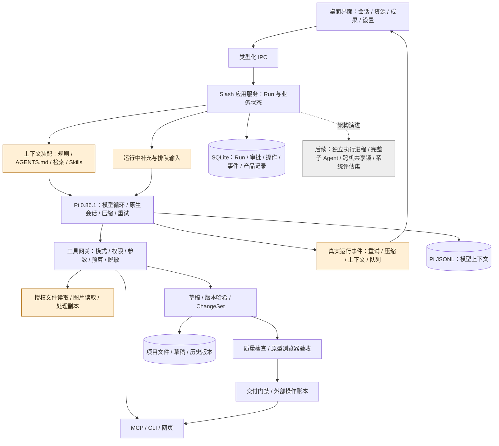

# Slash Agent 架构检查与 Pi 接入修复

日期：2026-10-07。范围：当前本地代码、安装的 Pi 0.86.1、LangChain / LangGraph / Deep Agents 官方文档。本文区分“有实现”“接入不完整”和“尚未验收”，不把历史设计图当成当前软件已经具备的能力。

## 结论

保留 Pi 作为唯一 Agent 执行底座。参考 LangChain 生态的职责划分、持久状态、人工介入、可观测与评估设计，不叠加第二套 Agent 循环，不为个人桌面版引入服务集群。

修复前审计发现核心链路没有完全接通：资源中的技能未成为模型可用的技能；目录图片不能按图片读入；运行中无法补充指令；原生重试、压缩和上下文状态对用户不透明。这些接入点的修复与验证见文末。另一方面，已经有相当多业务对象，但部分名称超前于实际能力，例如“子 Agent”接口目前执行的是受控单工具调用。

通俗解释：软件已经有不少按钮、文件夹和规则，但某些按钮背后的能力还没接到真正执行任务的引擎。应该先把这条执行链修好，而不是继续增加栏目，或换一套引擎从头接线。

## 参考 LangChain 的哪些设计

| 官方设计 | 对 Slash 的用途 | 本轮取舍 |
| --- | --- | --- |
| LangGraph 区分线程检查点与跨线程长期存储 | Pi 会话负责模型历史；SQLite 保存 Run、审批、成果、队列与产品知识 | 保留现有两种存储，明确每种状态唯一归属；不再做第二套历史压缩 |
| 人工中断是有状态的执行边界 | 审批、取消、继续不能只是一条聊天文字或内存 Promise | 继续使用持久审批与操作账本；追加输入有独立状态，重启不能猜测已经送达 |
| Middleware 在模型和工具调用前后执行策略 | 统一授权、输入校验、脱敏、预算和运行事件 | 用现有工具网关与 Pi 事件桥接实现，不引入 LangChain middleware 包 |
| Deep Agents 将执行环境、上下文、委派、人机介入分开 | 检查每一类能力是否真正端到端接通 | 借用能力清单，不照搬另一个 harness |
| 评估覆盖过程和最终产物 | “模型回复成功”不能证明原型可用或文件修改正确 | 保留本地协议夹具与真实业务用例，增加图片/技能/追加输入的链路证据 |

依据：[持久化与长期存储](https://docs.langchain.com/oss/javascript/langgraph/persistence)、[人工中断](https://docs.langchain.com/oss/javascript/langgraph/interrupts)、[执行中间件](https://docs.langchain.com/oss/javascript/langchain/middleware/overview)、[Deep Agents 能力分类](https://docs.langchain.com/oss/javascript/deepagents/overview)、[LangSmith 评估](https://docs.langchain.com/langsmith/evaluation)。本表是结合 Slash 代码作出的设计判断，不代表需要安装上述框架或上传工作资料到其云服务。

特别注意：LangGraph 恢复中断时会重新执行所在节点前面的代码。因此“换 LangGraph 就不会重复发布”是错误的推论。外部写入仍须依赖操作身份、回执、结果未知状态与人工核对。Slash 现有 `outcome_unknown` 保护必须保留。

## 应用与运行架构

源码图：[agent-architecture-review.mmd](diagrams/agent-architecture-review.mmd)。实线代表现有职责关系；橙色节点代表本轮补齐的接入点，灰色节点代表审计后仍需后续建设的能力。具体完成与验证结果以本文末尾及交付记录为准。

通俗解释：Pi 负责“思考下一步、调用工具、维护聊天上下文”；Slash 负责“这个项目能读哪些文件、改动有没有保存、是否允许发布、失败后怎样核对”。两者合作，而不是相互替代。

## 当前模块审计

下表列出修复前发现的接入缺口，以及本轮后仍需处理的结构问题。本轮 1—4 的实际修复和验证结果见文末，不应将下表中的修复前描述理解为这些入口仍未接通。

| 模块 | 源码证据 | 当前判断与缺口 | 优先级 |
| --- | --- | --- | --- |
| Agent 主循环 | `main/agent.ts`、`main/session-compaction.ts` | 已使用 Pi SessionManager、模型循环、自动压缩和重试；不应重复实现 | 保留 |
| Skills | `main/agent.ts`、资源页 | 修复前禁用自动发现，又未显式注入技能；仅展示文件夹不等于模型可使用 | 本轮 1 |
| 规则边界 | `main/agent.ts`、`main/agents-document.ts` | 工作空间规则已有显式装配；须关闭运行数据目录祖先的隐式规则扫描 | 本轮 1 |
| 文件与视觉 | `main/files.ts`、`main/vision.ts`、`main/prototype-browser.ts` | 聊天附件已支持图片；授权目录 read_file 仍为文本。浏览器验收已有基础，视觉结果需要进入模型可读链路 | 本轮 2 |
| 运行中人机协作 | `main/service.ts`、会话发送入口 | 同一会话禁止第二个并发 Run 是正确保护，但缺少 steer / followUp 的独立入口 | 本轮 3 |
| 运行状态可见性 | `main/agent.ts`、`main/store.ts` | 已有持久事件流与压缩回调；缺少完整重试、上下文估算及输入队列投影 | 本轮 4 |
| 工具与上下文预算 | `main/agent.ts` 的 availableTools / toolNames | Plan 已限定只读工具；Build 仍注册整套业务工具，尚未按任务提供更小的工具集合；应先测量请求体和实际调用，再渐进收敛，不能删掉必要工具 | 后续 P2 |
| 会话分支 | Pi AgentSessionRuntime、业务 Message | Pi 已有能力，业务消息尚需可靠关联原生 entry ID；不能按文本猜节点 | 本轮 5 评估 |
| 多供应商与扩展 | `main/model-runtime.ts`、`main/model-thinking.ts` | 已有多配置、协议与模型能力；OAuth 和任意 Pi 扩展不是当前失败根因 | 暂不扩大 |
| 权限与审批 | `main/capabilities.ts`、工具网关 | 已有 Plan/Build、三档权限、待审批生命周期；仍须逐条验证新入口不能绕过 | 贯穿本轮 |
| 长任务恢复 | `main/service.ts`、`main/store.ts` | 重启转 interrupted、结果未知核对已存在；Run、事件、审批及外部账本不是一个跨记录原子提交 | 后续 P1 |
| 子 Agent 与并行 | `main/phase3.ts`、Service.runSubAgent | 当前是白名单单工具调用及并发池，没有独立模型上下文的完整子 Agent；取消信号链需补齐 | 后续 P1 |
| 共享协作 | SharedResourceCoordinator、Files | 锁持久化到本机 SQLite，版本哈希能检查冲突；不等于多电脑共享一个锁服务 | 后续 P1 |
| 执行隔离 | Electron 主进程、PowerShell 网关 | UI/预览已有隔离；Agent 仍在主进程，Shell 不是 OS 沙箱，不能宣传完全隔离 | 后续 P1 |
| 应用服务边界 | `main/service.ts`、`main/main.ts` | IPC 与 UI 已分开，但运行、目录、模板、交付、协作仍大量汇集在 Service；后续按 Run/资源/交付逐步拆服务，保持单一权限网关 | 后续 P2 |
| 质量评估 | `tests/`、`scripts/`、真实任务报告 | 测试与验收脚本不少，但缺少固定数据集、统一指标和每版可对比报告；最近真实原型用例未通过 | 持续优先 |
| 执行完成与业务验收 | Service.execute 的 validating 分支、prototype-acceptance / delivery-gate | Run 在模型正常结束后可以 succeeded，计划也标 completed；这不代表所需成果、质量与业务条件已验收。已有专项检查和交付门禁，但尚需在明确的成果任务中汇总完成条件，普通聊天不应被强制要求产出文件 | 后续 P1，优先于扩功能 |
| PM 领域价值 | business-rules / product-records / prototype-acceptance | 已有需求证据、规则到实现映射、验收记录；价值取决于实际任务闭环，不取决于入口数量 | 保留并用真实任务验证 |

“后续 P1”是已发现的改进项，不属于本次五项均已修复的承诺。尤其不能把单工具调度宣称为成熟多 Agent 系统，把本地锁宣称为跨电脑排他锁。

执行环境的缺口会直接影响技能可用性：有的技能要求运行 Python 或 Shell。目前为了保护参考资料原件，包含受保护原件的工作区会限制任意宿主脚本；技能说明不会解除这个限制。现有 `main/reference-script.ts` 已提供隔离 Chromium 中的副本 JavaScript 处理，仅接收字节、不提供原路径或 Node API，它不等于通用 Python/Shell 环境。后续如需支持这类技能，应提供只读挂载原件、可写处理副本与显式成果出口的执行环境。把 Agent 移到独立进程只改善崩溃与卡顿影响，**并不等于操作系统沙箱**；两项必须分别设计与验收。

## 各系统协作契约

1. **上下文唯一归属。** Pi JSONL 保存模型消息和原生压缩历史；SQLite 不再压缩或维护另一套完整模型历史。当前恢复入口会把 SQLite 检查点中最多12,000字符的部分回复与已完成操作作为恢复提示附加给 Pi，这不是完整历史的替代来源。界面消息是产品展示记录，不能代替 Pi 恢复源。
2. **业务状态唯一归属。** Run、审批、输入队列、ChangeSet、交付结果由 Slash 保存。模型声称“完成”不能直接将这些对象设为成功。
3. **授权在工具实际执行时复核。** 发现技能、引用资料或排队时的授权，不代替读取/执行时的授权。撤权、取消、目录重定向和文件哈希变化均要使过期操作失效。
4. **资料不能改变权限。** Skills 和参考文件都是任务资料；脚本依然走原有工具策略，Plan 不因技能内容而开放写入或执行。
5. **运行事件是状态证据。** 队列消失不等于送达，HTTP 200 不等于生成完整，模型回复不等于文件已应用，上下文占用不等于任务完成进度。
6. **外部效果独立记账。** 已成功的发布不得因为“继续任务”重复执行；未知结果先核对。后续原子提交改进优先做 SQLite 内部状态与事件的一致性，不能声称本地事务可以让远端 API 原子化。
7. **失败可解释。** 至少区分用户取消、授权撤销、输出上限、连接失败、压缩失败、待核对；错误显示可操作的下一步，保留准确诊断，不用笼统“执行失败”覆盖原因。
8. **验证分层。** 单元测试验证规则；真实 Pi + 本地 HTTP 夹具验证集成；隔离桌面测试验证交互；真实上游业务任务验证质量。四者不能互相冒充。

## 五项实施顺序与验收

### 1. 授权 Skills

复用 Pi 解析器，发现范围限制在授权技能目录。提示中公布名称、用途及受控加载方法；正文按需读取；`/skill:name` 经宿主校验，不直接调用 Pi 的文件系统展开。保存发现诊断、正文哈希和加载回执。长文本读取提示使用应用真实支持的接口。

验收：正确发现/加载；无效与重复技能诊断；正文变化与撤权拒绝；符号链接不能逃逸；Plan 无法通过技能执行脚本；模型实际请求包含技能说明。

### 2. 目录图片与视觉反馈

补齐授权图片读取，并受格式、大小、模型视觉能力和目录权限约束。原型截图可经同样受控通道回看，图片内容不能执行为指令。保持截图、结构与交互检查的区别，不能把“有截图”当成“视觉质量通过”。

验收：图片以 image 内容进入真实 Pi 请求；非视觉模型返回明确限制；读取越界/撤权拒绝；截图关联实际被检查的已保存成果与依赖哈希；移动尺寸和基础可点击目标检查有浏览器证据。当前浏览器验收读取已保存文件快照，尚不支持直接执行待应用的 ChangeSet 草稿；不能宣称生成草稿后已自动完成视觉验收。

### 3. 运行中补充与排队

追加输入独立于新 Run 创建，继承当前模型、模式和权限。使用 Pi steer / followUp，不重写调度循环。每条输入有唯一 ID 与 queued / delivered / unknown / cancelled 状态，重启不盲重放，取消清空未送达队列。

验收：同文不同输入独立追踪；重复请求幂等；送达顺序；取消/撤权/启动结束边界；关闭再打开仍能解释未完成输入。

### 4. 重试、压缩和上下文状态

展示 Pi 的真实事件及 getContextUsage 估算，保存有界状态记录，避免记录密钥或思考正文。不自建第二套重试和压缩机制。压缩后未有可靠估算时显示未知，而不是 0%。

验收：本地模型夹具真实产生重试与压缩事件；成功、失败、取消可区分；重连能恢复显示；运行状态不泄露请求密钥。

### 5. 原生能力取舍

评估完成，决定本轮暂缓新增分支入口、额外 OAuth 供应商和任意扩展。

- **会话分支有 PM 使用价值**：可以从某次讨论另试方案，不干扰现有方向。但业务 `Message` 尚无可靠的 Pi 原生 entry ID；技能展开、工作流提示和图片准备会改写实际输入，不能按界面文字或时间猜测历史节点。Pi 的原生 `AgentSessionRuntime.fork` 还会替换运行时，接入时须保留 Slash 授权工具与资源加载器。后续先建立新消息映射，再提供“从这里另试方案”；旧记录无法核对就不开放。分支不能继承另一 Run 的待应用草稿写权限，也不能重放工具。
- **OAuth 暂缓**：当前 API key 与兼容协议已能配置所需模型。增加登录生命周期、刷新和凭据撤销不能解决当前长输出失败；有具体供应商需求再接。
- **任意扩展暂缓**：Pi 扩展可执行代码并添加工具，不能仅把 `noExtensions` 改为 false。须先定义可信来源、安装/更新/撤销与工具重新授权。
- **终端主题不接入**：Pi TUI 主题属于终端界面，Slash 已有桌面主题系统。

通俗解释：分支相当于从某一页复印一本工作笔记。现在还缺准确页码，不能凭内容相似就随便找一页复制；先确保页码对应正确，再做这个功能。

## 五项之后最值得做什么

下一轮优先补“任务验收结果”，而不是增加更多 Agent 名称或入口。对明确的原型/PRD修改任务，将目标、指定产出文件、已应用版本、必检规则、真实检查报告、用户仍需判断的部分放到一个可追溯结果里；模型正常结束只记作执行结束。规则不满足时显示未完成或待确认。普通问答仍可正常结束，不强制登记需求或检查清单。

随后再处理：运行状态与事件的事务一致性；按固定业务用例比较成功率、重复操作次数、耗时和人工修正量；执行进程与脚本环境；真正独立上下文的受控子 Agent；最后才是跨机协作锁。这里的顺序是本次代码审计后的建议，不是本轮额外实现承诺。

通俗解释：让软件先回答“这份成果是否真的交得出去、还差什么”，比让它同时开更多任务更有用。界面上出现“执行完成”，不能代替“东西已经做好”。

## 交付状态

- 阶段1已通过：Skills专项及相关运行/模式回归，真实 Pi 按需工具回合；详见 [授权项目技能接入](authorized-project-skills-2026-10-07.md)。
- 阶段2已通过核心与桌面链路：`.test-data/authorized-skills-images-CdEheE/report.json` 的6项组合检查，覆盖官方发送入口、Pi、本地模型协议夹具、真实 Chromium、技能/图片读取回执与纯文本模型拒绝；原型截图为390×844、1440×900、1280×800，记录原始 DPI 像素后显式归一化。`.test-data/prototype-viewport-smoke-QWOGgZ/report.json` 的6项浏览器检查覆盖横向溢出、触控目标、交互与网络阻断。主代理已查看工作台和手机截图。
- 阶段3/4已接入 Service、真实 Pi、IPC 与界面：运行中补充/本轮结束后处理沿用当前配置，取消或撤权清队列，重启不重发未确认输入；重试与压缩显示真实事件，未知上下文不显示为零。相关契约、边界与验收见 [运行中补充与原生运行状态](run-input-runtime-status-2026-10-07.md)。桌面5组检查通过，报告 `.test-data/run-input-runtime-status-20261007-064333-f13094/report.json`；主代理已查看1440/1100预览并排截图及关闭预览后的390会话截图。390预览覆盖聊天属于现有行为，单纯几何尺寸不作为被覆盖输入可操作的证明。
- 阶段5取舍已完成，具体原因见上文。

测试过程曾有两次失败，保留证据而不覆盖：隐藏窗口的初版辅助脚本错误修改 Electron 不可重定义的 `BrowserWindow` 导出，弹出错误框；已终止该测试进程，改为严格限制在 `.test-data` 下的隐藏测试窗口开关，并将辅助启动异常写入日志。另一次隐藏窗口 CDP 截图超时已改回 Electron 原生 `capturePage(stayHidden)`；不通过延长超时或伪造截图掩盖失败。最终两项桌面报告均通过，没有重启或操作用户正式应用、项目数据。

这些是本地协议与桌面集成证据，没有调用云模型。先前真实上游原型任务的失败不能被本地夹具通过替代；本轮尚不宣称该真实业务场景已修复。

全量回归首轮为395项、391通过、4失败，原始日志保留于 `.test-data/agent-repair-full-tests-2026-10-07.log`。发现并修复了任务先发布终态、再异步清理输入的收尾时序问题：正常和失败路径都先停止队列、取消待审批输入并等待迟到提交清理，再公布终态；最后同步保存回复完成信息与检查点。连接发现测试无需修改即通过；权限测试按撤权终止的真实语义拆分验证，仍断言无写入；提示词测试修正了将用户消息误选为助手回复的夹具错误。新增集成回归覆盖成功/失败终态与持久记录一致、待审批输入不能导致收尾死等。桌面截图对应后续收尾修正前的构建，报告记录该版本哈希；最终源码以本轮全量复测和构建日志为准。

最终集成验收：`npm test` **397/397 通过，无跳过**，`npm run check` 与 `npm run build` 均退出码0。日志分别为 `.test-data/agent-repair-full-tests-final-2026-10-07.log`、`.test-data/agent-repair-check-final-2026-10-07.log`、`.test-data/agent-repair-build-final-2026-10-07.log`。构建仍有既有的 Vite 单包超过500kB提醒，不属于构建失败；本轮未制作便携版。由于主进程代码有修改，用户下次关闭开发应用后，通过根目录启动BAT重新启动即可加载最终实现。
