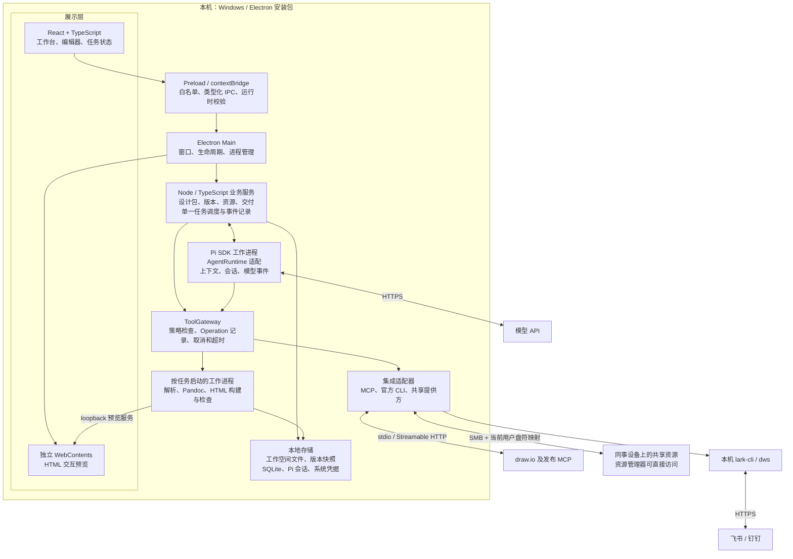
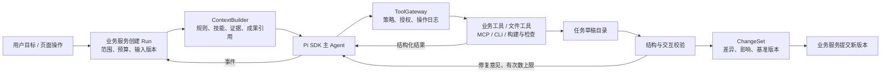
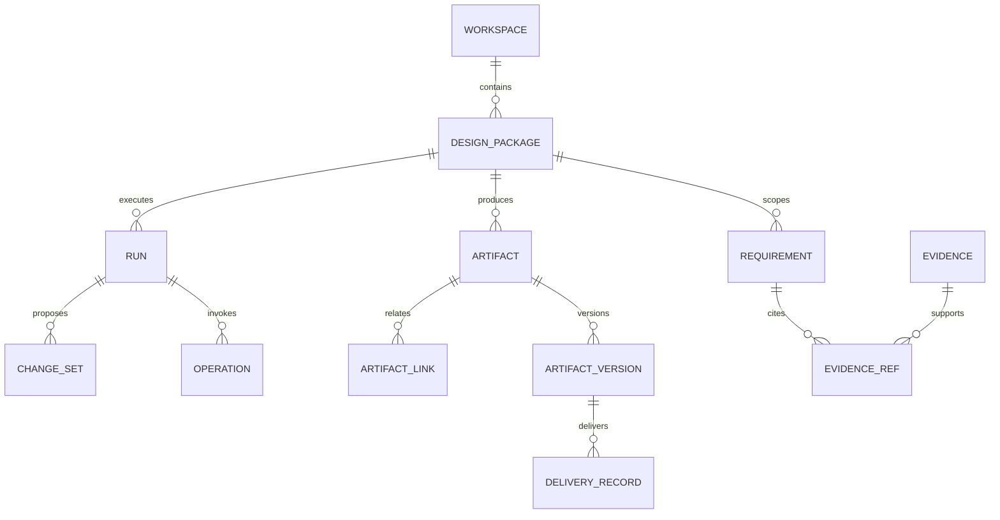
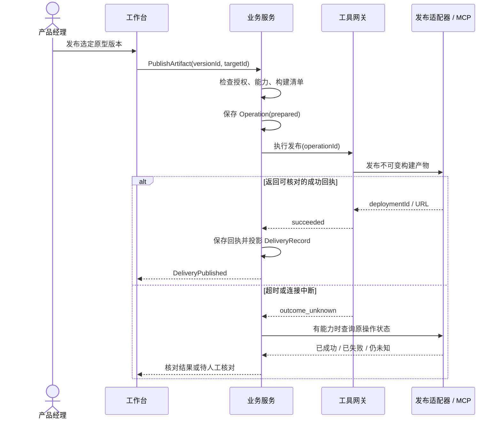

# slash 架构基线与协同规范

版本：v0.1 · 2026-09-21 · 设计基线，尚未实现或完成技术验证。

本文确定技术共同边界。应用与系统总图见 [architecture.md](architecture.md)。最新产品行为以 [product-spec.md](product-spec.md) 为准，开发契约和验收见 [development-handoff.md](development-handoff.md)。技术版本在验证后锁定，不把“采用某类能力”等同于“某个依赖已验证”。

2026-10-07增量：Slash全局技能由应用用户数据目录中的独立registry管理，项目技能同名优先；Pi继续解析技能并按需加载，Slash控制安装来源、只读范围、版本、开关和恢复。安装不自动运行第三方脚本或启用通用扩展。见 [全局技能当前实现及实测边界](global-skills-2026-10-07.md)。

## 1. 应锚定的九个架构视图

系统架构与技术架构在行业中有交叉，没有唯一统一的命名。slash 采用以下区分，避免一张图同时承担所有职责。

| 视图 | 回答的问题 | slash 的基线 |
| --- | --- | --- |
| 业务架构 | 为谁解决哪些工作问题 | B 端 PM；需求、调研、方案、原型、评审、变更、知识七项能力 |
| 应用架构 | 功能如何组织与协作 | 会话统一发起编辑，目录管理文件，设计包可选关联成果 |
| 系统架构 | 谁承担职责，通过什么边界通信 | 桌面界面、本地业务服务、Agent、工具网关、工作进程、外部适配器 |
| 技术与部署架构 | 用什么技术，在什么机器和进程中运行 | Windows 优先；Electron、React、TypeScript、Pi SDK、SQLite、本地文件 |
| Agent 执行架构 | 如何组装上下文、推理、调工具、停止和恢复 | 单主 Agent；业务流程宿主管理；Pi 承担会话与推理循环 |
| 数据与知识架构 | 谁持有真相，版本如何关联 | 文件持有业务内容；SQLite 持有运行状态；来源和版本显式关联 |
| 集成与协同架构 | 模块之间如何请求、响应、报错 | 版本化契约、命令与事件、适配器能力声明、统一操作流水 |
| 安全与信任架构 | 谁能访问什么，哪些内容不可直接执行 | 资料、原型、扩展分级；网关控制工具；预览与构建分离 |
| 质量与演进架构 | 如何判断正确，故障与升级如何处理 | 确定性校验、Agent 评测、恢复测试、依赖锁定、数据迁移 |

这些是同一套系统的九个视图，不是九个独立服务。

## 2. 核心决策

| 编号 | 决策 | 原因及约束 |
| --- | --- | --- |
| ADR-001 | 本地优先的模块化单体 | 个人先用；一个安装包；逻辑模块分离，不引入中心业务服务器、消息中间件或微服务 |
| ADR-002 | Windows 优先，Electron + React + TypeScript | 统一桌面、网页预览及 Node 工具宿主；Mac 支持需后续单独验证 |
| ADR-003 | 采用 Pi SDK，封装 AgentRuntime 接口 | 复用模型、会话、压缩和事件；业务层与 Pi 内部 API 解耦 |
| ADR-004 | 一个 Run 对应一个活动主 Agent | 首版不引入自治多 Agent；并行文件解析或检查由普通任务工作进程完成 |
| ADR-005 | 会话统一编辑，目录承载文件，设计包可选 | 可跨已授权目录查询；成果可独立存在；修改以成果资源为并发控制边界 |
| ADR-006 | 草稿生成、验证、版本提交三步分离 | 模型输出不直接覆盖正式成果；修改由 ChangeSet 表达 |
| ADR-007 | 所有产品工具调用统一经过 ToolGateway | UI 按钮和 Agent 使用相同业务接口、权限、操作记录；不提供绕过网关的 Shell 工具 |
| ADR-008 | 首版使用文件 + SQLite + 可替换检索接口 | 不预置独立向量数据库；中文检索实测不足时增加分词或混合检索实现 |
| ADR-009 | 优先官方集成，社区扩展经过适配和版本锁定 | 飞书、钉钉用官方 CLI；draw.io 用官方能力；Pi 社区候选以下载量初筛、兼容性验证定版 |
| ADR-010 | HTML 项目为原型源成果，静态构建包为默认交付 | 源码 ZIP、可运行静态包和在线链接分别记录；单 HTML 文件是可选导出，不承诺所有项目都能单文件化 |
| ADR-011 | LAN 首版采用 SMB + Windows 网络驱动器映射 | 同事连接后在“此电脑”看到盘符；共享协作账号使用 SMB Change + NTFS Modify，接收端完成读写探测后登记可写盘符；各设备独立会话和数据库 |
| ADR-012 | 外部写操作允许出现“结果待核对” | 网络超时不等于失败；无查询/幂等能力时不自动重复创建 |
| ADR-013 | 业务服务是唯一任务调度者 | Pi 或扩展的后台能力只作为执行器；不能形成第二套竞争调度和状态真相 |

ADR-002/003 为首版技术方向。Pi 具体版本、SQLite 驱动、MCP 社区适配器版本、打包更新方案仍须通过 Windows 联合验证后锁定。业务边界不随这些实现替换而改变。

## 3. 应用导航与业务归属

左侧导航：工作空间切换、会话、资源、成果、知识库、连接管理；底部为任务中心和设置。中间会话，右侧预览。成果内容修改均由会话发起；浏览和配置可直接操作。设计包是可选逻辑归组，不是强制入口或目录隔离边界。

- 资源负责“拿什么来参考和复用”：模板、规范、原始资料、素材、共享挂载。
- 知识库负责“哪些事实已被确认”：术语、规则、结论、适用范围、来源、失效状态。
- 会话负责“怎么发起和推进工作”；关闭会话页面不会删除任务或成果。
- 设计包可选地关联一次需求的成果；多个会话可参与，文件保留在原有授权目录。
- 连接管理负责 CLI、MCP、账号、能力和健康状态；交付由会话发起并关联成果版本。
- 设置负责系统策略、模型、目录、默认模板和规则；AGENTS.md 是可导出的规则载体，不承担权限执行。

文档模板拆成结构 schema、样式文件、生成说明三部分。章节稳定 ID 与显示标题分离；模板变更生成迁移预览和 ChangeSet，用户修改过的内容参与冲突检查。全局默认模板更新不静默改写已交付文档。

## 4. 技术架构图



上述逻辑分层不要求一个模块启动一个进程。主进程负责窗口；业务服务使用一个受监督工作进程；活动 Agent 和重任务按需创建工作进程并回收。网关、仓库和适配器默认是业务服务内模块，CLI/MCP stdio 服务按需派生子进程。SQL 运行状态写入集中在业务服务；工作进程通过接口请求状态变更。

预览服务只监听 loopback，验证 Host/Origin 并使用会话访问令牌；预览页面没有 Node 或业务 IPC 权限。元素选择桥只接受有限、校验后的消息。原型依赖安装与构建是独立执行权限，不能用网页隔离替代构建进程控制。

## 5. Agent 执行架构



### 5.1 Harness 责任划分

| Pi 承担 | slash 承担 |
| --- | --- |
| 模型请求与推理循环、会话历史、上下文压缩、流式事件 | 业务 Run、设计包、资源选取、成果关联、任务调度 |
| 自定义工具与技能的接入机制 | 工具策略与业务契约、可信扩展清单、确认流程 |
| 会话中止与继续的底层能力 | 中断判定、远端结果核对、业务检查点恢复 |
| 模型供应商抽象 | 模型配置 UI、预算、资料发送范围、错误呈现 |

采用“Pi 内核 + slash 宿主编排”。不重写推理循环，不把发布事务、文件版本或业务状态机交给模型自行维护。技能描述工作方法，业务服务执行不可省略的校验和状态转换。

### 5.2 上下文、记忆与权限

ContextBuilder 输出包含规则版本、技能版本、资料 URI/哈希、引用位置、截断说明和预算的 ContextManifest。在目录授权边界内，按显式引用、成果关联和任务相关性检索、排序、按需加载；设计包仅是相关性信号，不限制跨目录读取。保留原文入口。压缩摘要不是原始证据，知识变更不直接取自会话摘要。

产品控制规则与用户任务指令由宿主明确注入。资料、网页、评论、共享文件和工具返回以外部内容身份引用，不因包含“忽略规则”等文本改变控制策略。只加载本机用户启用的规则与扩展；外部 AGENTS.md 不自动成为可信规则。

每个 Run 固定模型、预算、工具范围和输入版本；允许用户明确修改并记录变更。预算含 token/金额可用估计、最长时间、工具次数、自动修复次数；无法获得真实金额时显示估计，不伪造精确费用。

默认允许已授权范围内的读取和任务草稿写入；正式成果提交、公开发布等动作遵循用户已经提供的授权及范围，不重复询问同一动作。破坏性或超范围动作必须另行授权。模型不能修改授权策略。

## 6. 数据与知识架构



ArtifactLink 保存 fromId/toId/relation/locator；一条关联有两个成果端点，图中仅简画归属。Decision/Rule、模板引用、共享挂载等完整字段见总览文档。

| 数据 | 唯一权威来源 | 其他地方如何使用 |
| --- | --- | --- |
| 原型、PRD、流程图、规则、知识、模板 | 本地文件 + manifest | SQLite 保存检索索引和引用 |
| 成果版本 | 不可变文件快照 + 版本 manifest | 当前工作文件可变化，交付绑定固定版本 |
| Run、Operation、持久事件、授权记录 | 本机 SQLite | UI 按快照和事件呈现 |
| 会话消息 | Pi 会话存储 | 业务库保存映射与必要摘要 |
| 发布结果 | 核对后的 Operation 回执 | DeliveryRecord 是可修复的业务投影 |
| 密钥 | 系统凭据存储 / 官方 CLI 登录存储 | 只保存凭据引用 |

同一成果资源的正式提交串行执行，多成果按固定顺序获取资源锁；同一数据库只有业务服务写入。长任务可并行准备草稿，提交时验证 baseVersions。外部编辑器仍可能同时改文件，因此哈希检查不是跨进程锁；发现不匹配停止覆盖，保留草稿和原文件。不能排除外部写入竞争时输出独立冲突副本，不承诺任意外部编辑器下的原子覆盖。

多文件变更使用提交清单、预写日志和旧版本快照，逐文件替换并记录进度；异常进入恢复流程。业务读取以已完成提交的版本 manifest 为准；不宣称文件系统与 SQLite 存在跨介质 ACID 事务。

知识条目使用 draft/confirmed/deprecated 状态，并记录适用范围、来源、确认者、时间及被替代关系。资料更新只标记关联结论需要复核，不能自动改写已确认业务规则。

## 7. 系统间协同契约

### 7.1 调用边界

| 调用双方 | 通信方式 | 约束 |
| --- | --- | --- |
| UI → 主进程 → 业务服务 | 白名单 IPC，请求与订阅 | 无任意命令入口；运行时校验 payload 和发送者 |
| 业务服务 ↔ Agent 工作进程 | 版本化消息协议 | start/steer/cancel/事件；Pi 对象不穿透到 UI |
| Agent → ToolGateway | 工具请求与结构化结果 | 不直连文件写入、MCP 或 CLI 执行通道 |
| 业务服务 → 存储 | Repository 接口 | 跨模块不得直接修改别人的表或 manifest |
| ToolGateway → 适配器 | 类型化方法 | 适配器负责平台差异，不持有业务调度权 |
| 适配器 → 官方 CLI | executable + argv 子进程 | 优先禁用 shell 拼接；超时、编码、退出码和业务结果均检查 |
| MCP 适配器 → MCP Server | 协商后的 MCP transport | 工具 schema 和能力变化要重新验证 |
| 原型 → 宿主 | 限定元素选择消息 | 不接受任意文件路径、脚本或系统调用 |

普通资料解析属于查询；业务状态更新必须由拥有该状态的模块执行。命令表示“请求做什么”，事件表示“已经发生什么”；消费者不能仅凭一个请求事件推断成果已提交。

### 7.2 统一信封与结果

以下为设计契约，不是 Pi 或 MCP 原生协议；由适配层转换。

```typescript
type Command<T> = {
  schemaVersion: 1;
  requestId: string;
  workspaceId: string;
  packageId?: string;
  runId?: string;
  type: string;
  payload: T;
  deadlineAt?: string;
};

type DomainEvent<T> = {
  schemaVersion: 1;
  eventId: string;
  streamId: string;
  sequence: number;
  correlationId: string;
  type: string;
  occurredAt: string;
  payload: T;
};

type ToolResult<T> =
  | { status: "succeeded"; operationId: string; data: T }
  | { status: "failed"; operationId: string; error: {
      code: string; message: string; retryable: boolean;
      retryAfterMs?: number;
    } }
  | { status: "outcome_unknown"; operationId: string;
      reconciliationRef?: string; message: string };
```

OperationId 在操作执行前分配和持久化；关联 requestId/runId/target/参数摘要/授权范围/预期版本。幂等键可基于 OperationId，但只有远端支持才具有远端去重语义。查询也可以有操作记录；不同操作的敏感输入按字段脱敏。

持久事件按 streamId 内有序，UI 用 eventId 去重并按 sequence 补读。启动时先读取状态快照，再订阅事件；保证快照水位与补读衔接，避免丢事件。token 增量属于临时展示流，可批量刷新；业务完成、等待用户和交付状态必须持久化。

统一错误码至少包括 AUTH_REQUIRED、PERMISSION_DENIED、DEPENDENCY_MISSING、CAPABILITY_UNSUPPORTED、VALIDATION_FAILED、VERSION_CONFLICT、RATE_LIMITED、TIMEOUT、CANCELLED、REMOTE_OUTCOME_UNKNOWN。具体供应商错误保留在脱敏诊断中，不能直接用退出码 0 代表远端业务成功。

### 7.3 发布、文档与共享适配器

- PublishProvider：inspectCapabilities、publish、query（可选）、update（可选）。能力声明包括 staticAssets、immutableUrl、idempotency、queryStatus；不支持的能力不得假定存在。
- DocumentProvider：inspectCapabilities、create、update（可选）、read（可选）、export（可选）。Word、飞书和钉钉的样式保真差异生成转换报告。
- ShareProvider：inspect、list、read、stat、disconnect；write 是后续可选能力。读取绑定资源标识和版本，不接受任意绝对路径。
- DiagramProvider：open、load、save、export 按实现声明；draw.io 浏览器打开工具不自动等于宿主文件保存能力。

### 7.4 发布时序图



图中业务服务查询由同一网关转发（为简洁省略该中继）；不得形成绕过网关的例外。

## 8. 任务状态、取消与恢复

Run 状态：queued → running → validating → ready_to_apply → applying → succeeded。任一执行阶段按条件进入 waiting_user、cancelling、failed 或 interrupted；cancelling 核对结束后才进入 cancelled。恢复和重试创建新 attempt，关联原 Run，保持历史事件不可变。

Operation 状态：prepared → executing → succeeded / failed / outcome_unknown。被取消但远端可能已经接受的写操作进入 outcome_unknown；不能仅因本地进程被杀就记录 failed。

| 情况 | 行为 |
| --- | --- |
| Agent 工作进程崩溃 | Run 记为 interrupted；保留 Pi 会话与草稿；检查未终结 Operation 后提供继续 |
| UI 窗口刷新 | 从业务快照和事件恢复；不重发原命令 |
| 用户取消 | 禁止派发新工具，尝试取消正在执行的任务；远端不可取消则核对结果 |
| 文件提交中断 | 按提交日志恢复或回退到完整版本；未完成版本不显示为已交付 |
| 发布超时 | 先查询；仅明确失败且可重试或远端幂等受支持时重试 |
| CLI 未登录 / 缺依赖 | waiting_user，显示具体配置入口；不反复启动同一失败命令 |
| 应用重启 | 扫描未完成 Run 与 Operation；不自动重放有副作用的调用 |

模型回复结束与业务任务成功是两个事件。必须通过校验、提交和必要的交付核对，才能满足相应 Run 的完成条件。

## 9. 局域网共享与信任边界

确定产品契约：选择目录、复制标准邀请、接收者粘贴解析、确认共享方与目录、选择盘符、按需认证、在“此电脑”中显示网络驱动器。首版使用 Windows SMB 与用户级持久映射，不开发虚拟磁盘驱动或应用内文件服务。

ShareProvider 负责资源接口；DriveMappingManager 负责当前用户的盘符和映射；受限提权助手只在创建端处理共享与权限。资源管理器直接访问 SMB，绕过应用网关是预期路径，因此读写权限由 SMB 与文件系统共同执行。

邀请格式为 `slash-share:v1:<base64url-json>`，含 provider、resourceId、host、shareName、displayName、suggestedDrive。base64url 只是编码；不携带密码，不把邀请当授权令牌。解析后验证 SMB 目标并展示给用户，禁止执行邀请中的任何命令。SMB 账号认证独立完成，凭据存 Windows 安全存储。

首版仅共享选定资源，不共享活动运行库、凭据或执行接口。断开盘符不删除文件；创建者离线时映射可保留但无法读取。应用缓存另行标记来源与时间；已复制内容不能远程追回。详细流程、盘符冲突、账号冲突与验收见 [网络盘共享设计](sharing-network-drive.md)。

资料与原型默认不可信；扩展、CLI 和构建脚本属于代码执行。首版只加载用户启用的可信扩展、受控构建工具；进程隔离仅用于生命周期和故障隔离，不宣称等同系统沙箱。承诺运行任意不可信项目之前，需要另行实现系统级沙箱后端。

## 10. 质量、部署与演进

### 10.1 验收矩阵

| 类别 | 必须覆盖的代表场景 |
| --- | --- |
| 业务一致性 | 修改审批角色后，原型、PRD 与权限矩阵的关联影响可定位 |
| 模板演进 | 章节提一级不丢正文；已人工修改的章节产生可审查冲突 |
| Agent 评测 | 固定需求样例验证资料引用、工具选择、约束遵守与可运行成果；不要求自然语言逐字一致 |
| 工具契约 | MCP schema 变化、CLI 登录过期、错误 JSON、缺依赖和非零退出 |
| 原型交互 | 核心流程、角色切换、表单校验、状态变化和直接路由访问 |
| 故障恢复 | 发布后断网、提交中退出、取消期间远端成功、事件重连 |
| 权限 | 原型无法调用业务 IPC；共享路径越界被拒绝；外部资料不改变控制策略 |
| 安装升级 | 干净 Windows 设备安装；CLI 发现；运行库迁移失败可恢复 |
| 中文资料 | 中文搜索、Word 样式、draw.io 中文字体和导出效果 |

用固定业务案例建立可重复评测集；模型评价与确定性检查分别统计。运行诊断包含 traceId/runId/operationId、时长、退出码和 token 用量，默认不记录完整敏感正文；导出诊断前可预览脱敏内容。

### 10.2 版本和依赖策略

使用单仓库组织 desktop、contracts、domain、application、agent-runtime、tool-gateway、integrations、storage 和 workers。只有 contracts 可被全部层依赖；domain 不依赖 Electron、Pi、CLI 或 UI。这是依赖边界，不要求每个目录独立发布 npm 包。

应用包、业务 manifest schema、数据库 schema、工具契约分别版本化。升级先备份并执行可验证迁移；回退代码前确认数据兼容，不默认保证任意降级。Pi 与社区扩展锁定联合验证的版本，升级经过契约测试和业务样例评测。

首版应用使用本机已有官方 CLI，连接管理检测路径、版本和登录状态。Pandoc、解析器及其运行时采用可配置依赖清单；打包分发前决定随包提供或引导安装，检查许可、体积及升级机制。不能假定用户机器已有 Python、Pandoc 或 Node 构建工具。

## 11. 开发入口与验证顺序

1. 先定义 contracts 和设计包 manifest：以同一组 mock 数据驱动 UI 与业务服务，确定状态与错误呈现。
2. 打通 PiRuntime → ToolGateway → 草稿文件 → 校验 → ChangeSet → 新版本闭环，验证所有工具路径受控。
3. 实现独立原型预览及 HTML 项目构建，验证 Windows 路径、进程回收和浏览器隔离。
4. 接入一个发布 MCP、飞书和钉钉官方 CLI，验证创建、更新、超时和结果核对。
5. 加入模板迁移、评审影响分析和固定业务评测集。
6. 双机验证 SMB 认证、当前用户盘符可见性、重启重连、断线与权限；完成安装、迁移和备份测试。

不确定项由验证结果决定，不改变既定接口：Pi/扩展兼容性、中文检索实现、Windows 共享环境兼容性、依赖分发和自动更新实现。当前无需引入中心账号系统、实时多人协同、向量服务或多 Agent 编排平台。

## 12. 官方依据

以下资料支持底层能力与边界；本文中的业务模型、接口和状态机是 slash 自身的设计。

- [Pi SDK：自定义宿主、会话、工具与事件](https://pi.dev/docs/latest/sdk)
- [Pi 安全模型](https://pi.dev/docs/latest/security)
- [Electron 进程模型](https://www.electronjs.org/docs/latest/tutorial/process-model)
- [Electron 安全指导](https://www.electronjs.org/docs/latest/tutorial/security)
- [MCP 传输规范](https://modelcontextprotocol.io/specification/latest/basic/transports)
- [飞书官方 CLI](https://github.com/larksuite/cli)
- [钉钉官方 CLI](https://github.com/DingTalk-Real-AI/dingtalk-workspace-cli)
- [draw.io 官方 MCP](https://github.com/jgraph/drawio-mcp)
- [其他工具选型、官方与社区边界](architecture.md#8-技术选型与复用边界)
