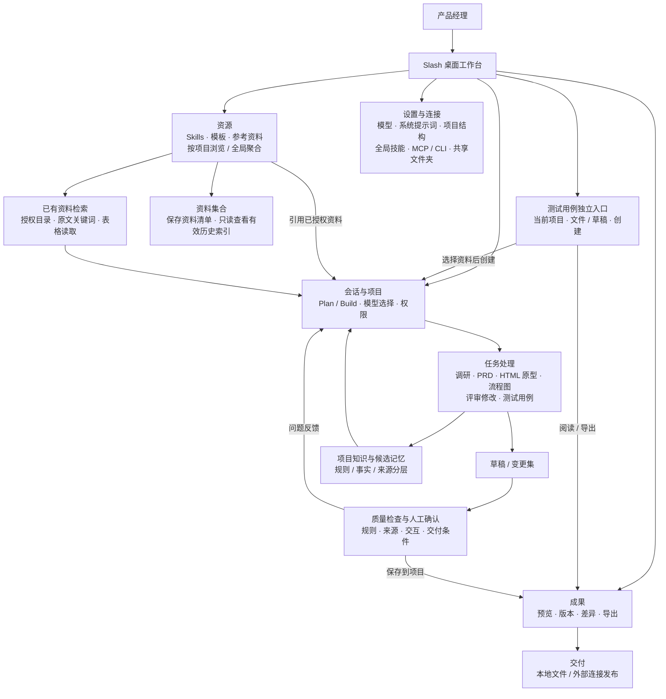
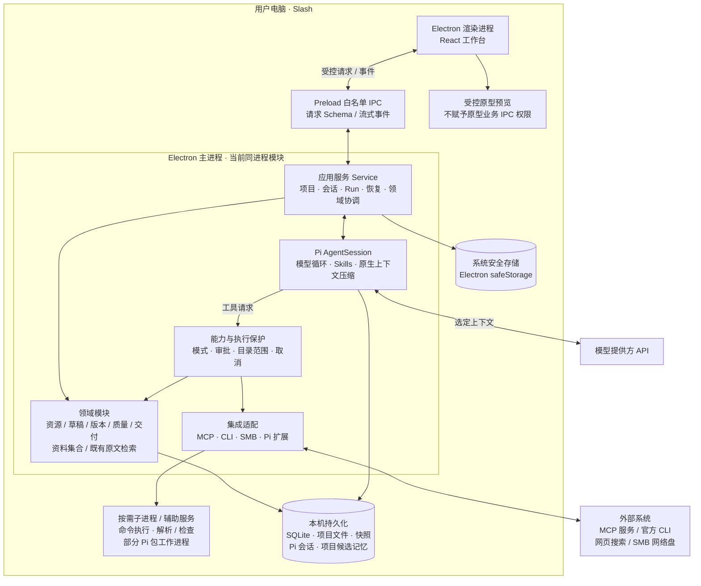
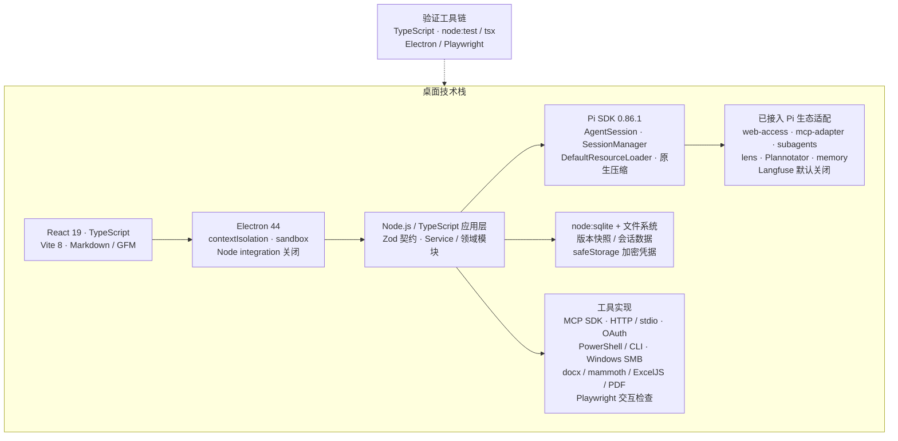

# Slash 当前架构图

日期：2026-10-09。性质：当前启用功能的实现快照。当前形态为**本地优先的模块化桌面应用**。云知识库已从产品移除，向量构建与查询入口停用；历史网页源码、远端部署及数据仍保留，未执行删库或下线。详见 [功能收减](knowledge-retirement-2026-10-09.md)。

| 图 | 回答的问题 | 阅读重点 |
| --- | --- | --- |
| 应用架构 | 产品有哪些功能，如何一起完成 PM 工作？ | 会话统一编辑，资源提供依据，成果承接交付 |
| 系统架构 | 哪些程序运行在哪里，数据如何流动？ | 进程边界、本机与云端、身份和权限 |
| 技术架构 | 各部分用了什么技术？ | Electron / React / Pi / SQLite |

## 1. 应用架构

评审、决策和业务规则是已有工作流中的能力，不表示侧栏新增独立中心。资源与成果有全局入口，也有项目范围入口；知识库集合属于资源能力。模型给出草稿，保存、权限、版本和交付结果由宿主服务检查，不能由模型自行宣布通过。

## 2. 系统架构

- **当前主 Agent 和 Service 运行在 Electron 主进程内**，并非独立后台服务器，也不是所有工具都在独立进程中。部分 Pi 包、命令、解析及检查使用工作进程或辅助服务。
- 图中的“能力与执行保护”是现有 capability broker、授权读取、路径核对和具体执行检查的合并表示，不是一项独立部署服务。会话工具经能力控制；界面直接发起的管理动作经 IPC Schema、领域授权和显式确认。
- 主会话的持久化与上下文压缩继续复用 Pi。受控子 Agent 继承父任务权限，不自动获得写入或发布能力。
- 原始参考资料保持只读；需要转换时操作处理副本。草稿、变更集和版本快照独立于原件。
- 云知识库与向量服务没有桌面初始化或可用 IPC 入口；历史回执、加密凭据和索引保留。普通模型连接、官方 MCP、CLI 与 SMB 保持独立。

## 3. 技术架构

桌面图中只标注关键依赖版本，完整声明以根目录 package.json 和锁文件为准。2026-10-13 已将 knowledge-web/ 及退役云发布实现完整迁入忽略的本地 `过程文件/历史模块/knowledge-web/`，当前源码、检查、构建与启动不再依赖该工程；资料集合与旧数据兼容仍由现有本机模块承担。见[退役源码清理](knowledge-source-cleanup-2026-10-13.md)。

## 4. 当前状态与边界

| 能力 | 当前状态 |
| --- | --- |
| 桌面会话、资源、成果、设置及受控执行 | 已实现；具体质量以对应功能验收为准 |
| Pi 原生会话、上下文及七项生态适配 | 已接入；不替换成 billion-context，Langfuse 默认关闭 |
| Skills / 模板 / 参考资料与全局技能 | 已实现；目录授权、来源及原件保护继续有效 |
| 资源内资料集合与有效历史索引查看 | 保留；不要求向量服务配置 |
| 云知识库发布与独立问答 | 已移出产品范围；远端部署和历史数据未删除 |
| 专用向量构建、查询、配置与导出 | 产品入口及 IPC 已停用；已有普通资料检索继续使用 |
| 团队在线协作、跨设备同步、插件市场 | 不属于当前完成范围；SMB 分享不等于在线协同编辑 |

代码存在不代表全部场景已认证；当前架构也不代表所有主进程能力已完成进程隔离。

## 5. 主要代码对应

| 架构部分 | 主要文件 |
| --- | --- |
| 桌面 UI / 项目导航 | src/App.tsx、src/Sidebar.tsx、src/ProjectResourcesBrowser.tsx |
| IPC 与桌面宿主 | main/main.ts、main/preload.cts、shared/types.ts |
| 本地应用服务与能力控制 | main/service.ts、main/capabilities.ts、main/authorized-read.ts |
| Pi 执行与工具适配 | main/agent.ts、main/tool-catalog.ts、main/pi-*.ts |
| 本机状态与资料 | main/store.ts、main/files.ts、main/artifacts.ts、main/draft-edit.ts |
| 质量与交付 | main/delivery-gate.ts、main/content-review.ts、main/prototype-acceptance.ts |
| 资料集合与历史读取 | main/knowledge-base.ts、src/KnowledgeCollections.tsx |
| 已有原文检索 | main/files.ts、main/evidence-search.ts |

以下为退役前历史证据，不再作为待完成项目： [云知识库验收](knowledge-cloud-deployment-2026-10-08.md)；桌面发布验收见 [桌面发布说明](knowledge-cloud-desktop-2026-10-08.md)。

独立 Mermaid 源文件：
- [应用架构](architecture-current-application.mmd)
- [系统架构](architecture-current-system.mmd)
- [技术架构](architecture-current-technical.mmd)

早期 docs/architecture.md 保留为历史设计提案；当前实现以本文及最新交付记录为准。
