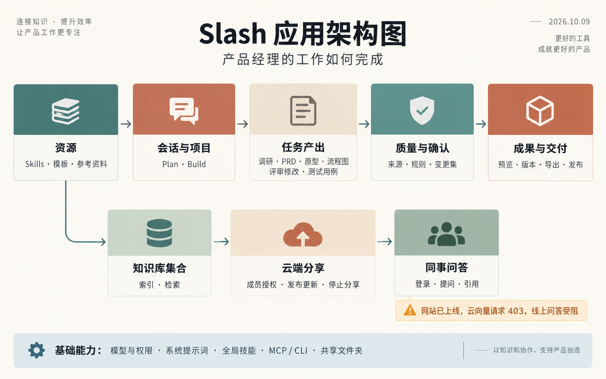
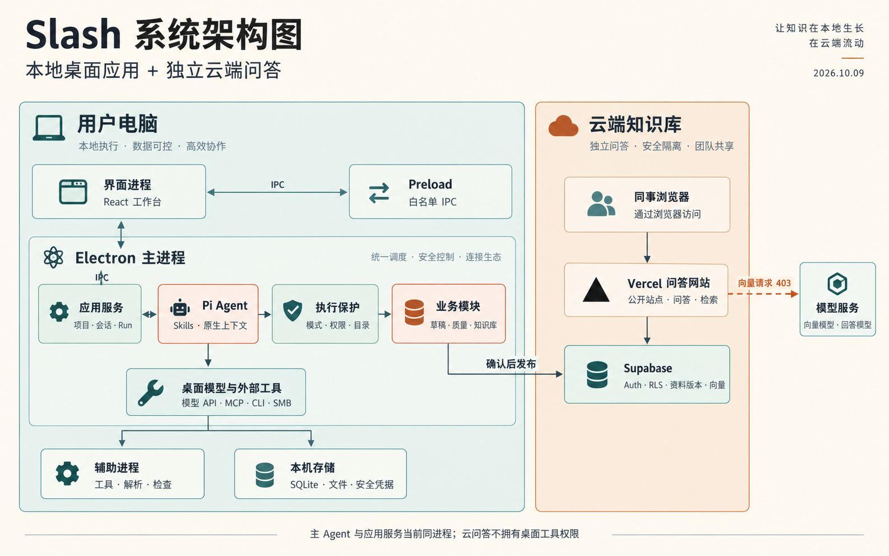
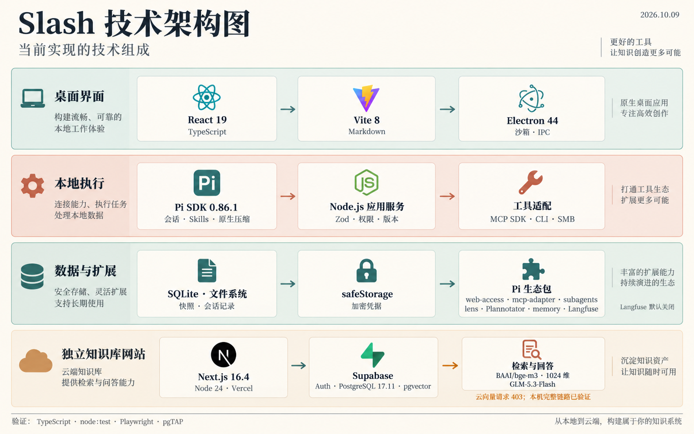

# Slash 架构图（生图版）

2026-10-09 范围调整后，下方 PNG 仅为此前实现的历史快照，云知识库已退出产品。当前架构以 [更新后的说明与 Mermaid](../architecture-current.md) 为准；图片保留，不重新制作演示材料。

2026-10-09。根据当前实现生成的三张 PNG 图片，未使用代码绘图。图中分组是架构示意，精确模块边界参见 [实现说明](../architecture-current.md)。

## 应用架构图

## 系统架构图

## 技术架构图

当前限制：Vercel 网站已部署，但向量服务对云端请求返回 HTTP 403；线上问答尚未可用。主 Agent 与业务服务当前在 Electron 主进程内；部分工具使用辅助进程。
