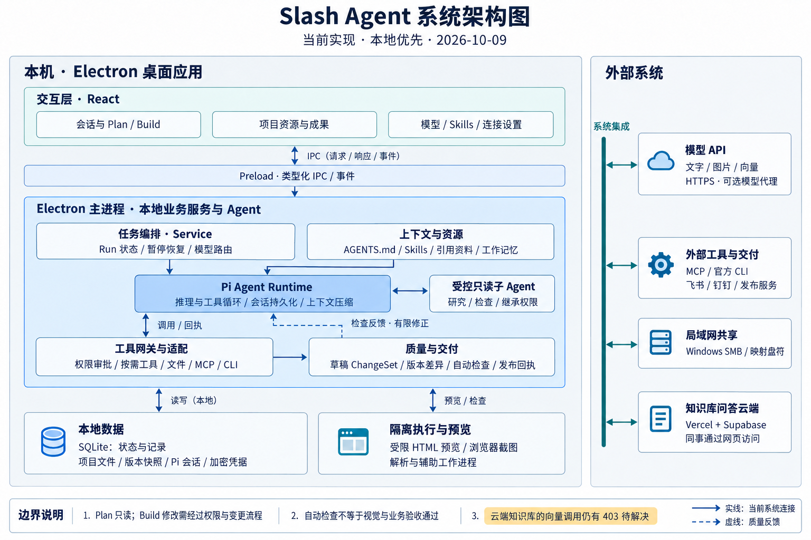

# Slash Agent 系统架构图

依据 2026-10-09 当前代码绘制；采用内置 Imagegen 生图，不是代码渲染图。完整初始提示词见同目录 `slash-agent-system-2026-10-09-prompt.txt`。第二次编辑仅将右侧错误的模块间连线改为外部系统汇总连接。

## 阅读说明

- 本地优先的模块化桌面应用。当前 Service 和 Pi 主 Agent 在 Electron 主进程内协作，不是独立微服务或独立 Agent 工作进程。
- 右侧“系统集成”竖线仅汇总外部依赖，不代表实现了消息总线。模型由模型 runtime 连接；CLI/MCP/SMB 由相应适配器连接；知识库发布由专门发布服务处理。子 Agent 不直接绕过权限调用外部工具。
- Pi 管理模型循环、会话与压缩；Slash 管理任务、授权、资料范围、草稿、成果版本及交付。
- 受限原型预览与辅助工作进程不代表所有本机命令都具备操作系统沙箱。
- 自动检查与图审已有实现，但不能因此声称真实业务和视觉质量全部通过。
- 云问答部署已存在；Vercel 调用向量上游的 403 为既有未解决项，图中按最近验收记录标注，本次未重新测试云服务。

## 源码依据

| 图中模块 | 主要依据 |
|---|---|
| 桌面界面与 IPC | src、main/preload.cts、main/main.ts |
| 任务编排 | main/service.ts、main/run-inputs.ts、main/pm-workflows.ts |
| Pi 与模型连接 | main/agent.ts、main/model-runtime.ts、main/model-proxy.ts、main/session-compaction.ts |
| 上下文、技能、记忆 | main/agent-index.ts、main/skills.ts、main/global-skills.ts、main/pi-memory.ts |
| 受控子 Agent | main/pi-subagents.ts |
| 工具与权限 | main/tool-catalog.ts、main/capabilities.ts、main/integrations.ts、main/mcp-host.ts |
| 质量与交付 | main/task-acceptance.ts、main/task-completion.ts、main/prototype-visual-review.ts、main/delivery-gate.ts |
| 数据与版本 | main/store.ts、main/files.ts、main/artifacts.ts |
| 预览与浏览器检查 | main/preview.ts、main/prototype-browser.ts |
| 局域网共享 | main/network-share.ts、main/sharing-setup.ts |
| 云知识库 | main/knowledge-publication.ts、docs/knowledge-cloud-deployment-2026-10-08.md |

本图未把团队角色、跨设备同步、完整在线协作等规划项画成当前能力。
