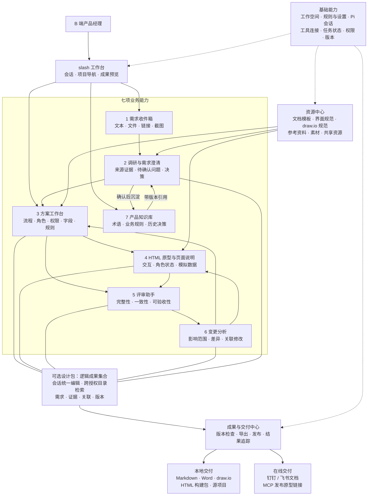
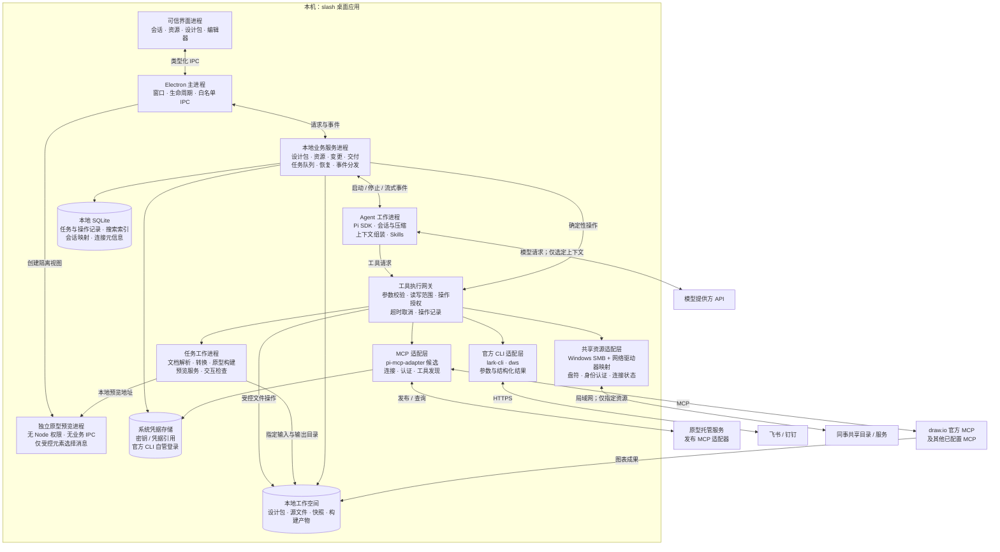

# slash 应用架构与系统架构

当前实现快照（2026-10-08）请查看 [技术、系统、应用三类架构图](architecture-current.md)。本文保留早期提案；其中独立业务进程、候选技术及部分菜单布局不代表当前实现。

版本：v0.1 · 设计提案 · 2026-09-21

产品行为更新：会话统一发起全部成果编辑，文件按目录管理，允许跨已授权目录检索；设计包为可选逻辑集合，不要求先创建或迁移文件。本文目录结构仅为早期示例，实际默认结构以 [产品规格](product-spec.md) 为准；开发契约见 [开发交付规范](development-handoff.md)。

## 1. 设计范围与决策

slash 面向个人使用的 B 端产品经理，覆盖需求收集、调研与澄清、方案设计、HTML 交互原型、PRD、评审、变更和知识沉淀。支持局域网共享资源；原型交付 HTML 项目或通过 MCP 发布的链接；文档交付 Markdown、Word、钉钉和飞书。

采用本地优先的模块化单体：一套桌面应用、一套本地业务服务，按稳定职责拆模块；Agent、解析、构建等重任务使用独立工作进程。首版不部署中心业务服务器，不拆微服务。模型请求、在线调研和远端交付仍可能使用网络，本地优先不等于离线运行。

本提案以 Pi SDK 为执行基底，Electron + TypeScript 为桌面技术方向。前端建议 React；这些属于架构建议，尚未通过原型验证或安装运行。按用户要求，共享连接必须在同事 Windows 的“此电脑”中显示网络驱动器盘符，因此首版确定采用 SMB + 用户级网络驱动器映射。邀请文本用于连接配置，不替代 Windows 身份认证。

## 2. 应用架构图



图中的业务箭头表示常见协作关系，不是强制向导。用户可以从已有 PRD、原型或评审意见开始；调研归入需求澄清，同时允许直接创建独立调研任务。

### 应用模块职责

| 模块 | 主要对象与职责 | 明确边界 |
| --- | --- | --- |
| 需求收件箱 | 收集输入，形成需求卡片，保留原始来源 | 不把模型推断当作已确认需求 |
| 调研与澄清 | 多资料分析、问题清单、证据、决策、临时假设 | 资料变化后标记结论可能过期 |
| 方案工作台 | 角色、字段、规则、流程、PRD、验收清单 | 统一标识与关联，避免每份成果各自维护一套事实 |
| 原型与页面说明 | HTML 项目、路由、角色状态、模拟数据、元素修改 | 默认模拟业务；真实接口需另行配置 |
| 评审助手 | 规则检测与模型审阅、问题定位、采纳记录 | 区分可确定的错误与主观建议 |
| 变更分析 | 评审反馈、影响清单、变更集、版本差异 | 用户选择应用范围；不静默重写全部成果 |
| 产品知识库 | 术语、规则、决策、有效期、适用范围 | 明确确认、发布、失效动作 |
| 资源中心 | 模板、规范包、资料、素材、共享挂载 | 共享文档默认是资料，不自动加载为可执行扩展 |
| 成果与交付 | 导出、构建、发布、远端链接、失败核对 | 发布成功与否以工具返回及必要的远端查询为准 |

## 3. 系统架构图



架构中的工具网关是目标调用边界，不代表安装一个权限插件就自然覆盖所有执行路径。Pi 内置 Shell、文件工具及可直接执行代码的扩展必须替换、包装或限制；不能一边声明统一控制，一边保留绕过网关的工具。受信任的扩展代码与操作系统隔离也不是同一回事。

### 3.1 视觉辅助桥接

图片输入经过独立的 VisionBridge，不直接作为未经说明的模型上下文注入。桥接层负责文件类型与大小校验、图片哈希、视觉模型能力选择、协议适配、结构化证据校验、本地缓存和失败回退：


当前模型不支持图片时，只有用户在模型设置中明确标记 `supportsVision` 的条目可以作为回退目标；关闭自动回退后，系统会明确提示配置缺失。视觉结果不会改变目录授权、权限模式或交付状态，也不会自动写入成果。视觉请求失败、返回非标准 JSON 或缓存失效均保留可诊断状态，并将不确定性传递给会话。

Electron 工作进程隔离用于故障隔离，不等于任意命令的安全沙箱。HTML 页面预览与依赖安装、构建脚本执行是两个不同边界：后者需要受控命令和最小环境；要运行不受信任项目时，再提供系统沙箱/容器执行后端。

图中 draw.io 表示能力接入：浏览器打开型工具未必生成本地文件，本地落盘、桌面导出应由适配器调用对应官方能力完成。不同发布 MCP 也需逐一实现与验证发布契约。

## 4. 关键数据模型

关系主线：Workspace → FolderMount / Conversation / Artifact → ArtifactVersion → DeliveryRecord。DesignPackage 可选关联多个 Artifact，不是文件容器或访问权限边界；成果可不归属于任何设计包。完整更新见开发交付规范。

| 对象 | 关键字段/关系 | 用途 |
| --- | --- | --- |
| Workspace | id、rootPath、schemaVersion、settings | 本地项目与目录配置 |
| DesignPackage | id、title、scope、status、关联需求 | 一项需求或版本的工作集合 |
| Requirement | id、sourceRefs、acceptanceRefs、status | 保留诉求与验收关系 |
| Evidence | id、sourceUri、sourceHash、locator、capturedAt | 来源追溯与过期判断 |
| Decision / Rule | id、revision、status、scope、evidenceRefs | 已确认规则与临时假设分开保存 |
| Artifact | id、kind、path、templateId、templateVersion | 原型、PRD、流程图等成果 |
| ArtifactLink | fromId、toId、relation、locator、confidence | 页面、规则、PRD 段落之间的显式关联 |
| ArtifactVersion | id、artifactId、contentHash、snapshotPath | 不可变成果快照 |
| ChangeSet | id、baseVersions、affectedRefs、patches、state | 可预览、校验、应用和回退的变更 |
| Run | id、packageId、piSessionId、state、lastEventSeq | 业务任务与 Pi 会话映射 |
| Operation | id、runId、target、requestHash、state、receipt | 记录每次具有副作用的工具操作 |
| DeliveryRecord | artifactVersionId/contentHash、targetId、remoteId、url、state | 确认某个链接对应哪一版成果；本地交付门禁同时绑定当前文件哈希、连接、服务商和目标 |
| ShareMount | id、resourceId、uncPath、localDrive、persistent、status、credentialRef | SMB 资源与当前用户盘符映射 |

显式关联是影响分析的第一依据；模型对未关联内容做补充检索时，结果标为候选影响，不能保证完整覆盖。HTML 中的元素标识也需要维护与重新定位，不能假定一次插入后永不变化。

## 5. 文件与数据库的权威来源

- 原型代码、文档正文、模板、规则、知识条目及其 manifest：工作空间文件为权威来源，便于复制、备份和外部编辑。
- 搜索索引、文件扫描缓存：SQLite 为可重建数据，不作为唯一原始资料。
- 任务、操作流水、事件序号、连接元信息、Pi 会话映射：本机 SQLite 为权威运行记录。
- Pi 会话历史：Pi 会话存储为权威；SQLite 仅保存引用和必要的 UI 摘要，不维护另一套完整会话真相。
- 发布结果：先持久化操作流水，再把已核对结果投影到设计包交付记录；通过操作 ID 重放修复文件与数据库间的中断。
- 在线发布前由 `DeliveryGate` 生成按工作空间、成果路径与内容哈希、连接和目标组成的检查身份。预检、人工内容/目标确认、审批和执行复核共享该身份；质量项可按设置关闭，但版本冲突、未解决评审/需求问题、`outcome_unknown` 和未确认目标不能绕过。门禁结果是可持久化的检查投影，不能替代最后一次文件哈希复核。
- 密钥与令牌：不进入项目目录、共享目录或 AGENTS.md。自有密钥存系统凭据存储；官方 CLI 优先自管认证。
- 每台设备独立维护运行数据库，禁止将一个活跃 SQLite 数据库直接放到 SMB 目录供多台设备共同写入。

建议目录：

```text
工作空间/
├─ AGENTS.md
├─ .slash/
│  └─ workspace.json
├─ 需求收件箱/
├─ 资源/
│  ├─ 文档模板/
│  ├─ 界面规范/
│  ├─ 流程图规范/
│  ├─ 参考资料/
│  └─ 素材/
├─ 设计包/
│  └─ 客户准入审核/
│     ├─ manifest.json
│     ├─ 调研与澄清/
│     ├─ 业务规则/
│     ├─ 原型/             # src、assets、mock、项目启动与构建说明
│     ├─ PRD/
│     ├─ 流程图/
│     ├─ 评审与变更/
│     └─ 交付/
└─ 产品知识库/
```

运行数据库、Pi 会话、共享缓存和快照默认保存在应用数据目录，并提供可配置的备份/迁移功能。导出完整项目时需说明是否包含版本与交付历史。公开发布仅上传所选构建产物，不上传整个工作空间。

## 6. 三条核心执行链路

### 6.1 生成原型和 PRD

1. 业务服务创建 Run，固定输入资料、规则及模板版本。
2. 上下文组装器按需加载内容，保留 evidence 引用；不把整个资料库一次性装入上下文。
3. Pi 调用受控工具，在任务输出目录生成原型、PRD 和流程图草稿。
4. 工作进程运行结构检查、原型构建及关键交互检查；模型审阅作为补充。
5. 预览结果，生成 ChangeSet；应用时比较基准版本，冲突则停止覆盖。
6. 保存成果版本及关联关系，更新 UI。

### 6.2 评审后关联修改

1. 导入评审意见，明确目标成果版本。
2. 依据显式关联和补充检索生成影响清单。
3. 明确规则变动与待确认事项，选择应用范围。
4. 在草稿区修改，运行一致性与交互检查。
5. 对比当前文件与 baseVersions，避免覆盖用户刚做的修改。
6. 应用变更并保存新快照；恢复历史内容会生成一个新版本，不会撤销远端已经发生的发布。

### 6.3 MCP 发布 HTML 原型

1. 选择不可变原型版本，构建静态发布包，生成文件清单与内容哈希。
2. 检查发布适配器是否支持该产物类型、创建/更新/查询以及固定版本链接。
3. 记录待执行 Operation，调用已配置的发布 MCP。
4. 保存远端部署 ID、URL 和结果，再查询或访问验证部署状态。
5. 超时进入 outcome_unknown，先核对远端结果。服务没有幂等或查询能力时不能盲目重试；转为需要人工核对。
6. 保存 DeliveryRecord。固定版本链接与会随更新变化的站点链接分别标注。

首版发布契约优先覆盖静态 HTML/JS/CSS；需要后端、SSR 或数据库的原型要由支持对应环境的适配器承担，不能将“可本地运行”直接等同于“可静态发布”。

## 7. 共享架构与邀请文本

首版采用 Windows SMB，连接成功后在接收者“此电脑”中出现例如 P: 的网络驱动器。ShareProvider 管理资源读取；DriveMappingManager 管理盘符、映射与重连；创建端通过受限提权助手管理 SMB 共享和权限。详见 [网络盘共享设计](sharing-network-drive.md)。

- 创建端：选择目录、指定授权账号和权限、创建共享、输出格式化邀请。共享权限和文件系统权限共同约束访问。
- 接收端：粘贴邀请、展示共享方和目标、选择空闲盘符、按需完成 Windows 认证、建立持久映射并验证资源管理器可访问。
- 映射属于当前桌面登录用户，不能只在管理员进程或服务身份中创建；退出 slash 默认保留映射。
- 创建者关机、休眠或网络断开时，盘符可能保留但内容不可访问。应用缓存与网络盘分开，不承诺离线可读。
- 共享资源的访问模式由 Windows SMB 与文件系统共同强制实施；slash 创建或升级共享时为指定账号授予 SMB Change 与 NTFS Modify，连接端只有完成实际读写探测后才登记为可写挂载。普通参考目录仍可单独保持只读。
- 断开映射、删除已保存凭据、停止共享是三个独立动作；不删除远端原始文件。

## 8. 技术选型与复用边界

| 组件 | 推荐候选 | 需要补的工作 |
| --- | --- | --- |
| 桌面 | Electron + TypeScript；React 界面 | 设计包工作台、IPC 契约、安装与生命周期 |
| Agent | Pi 完整会话 SDK | 上下文、业务任务、工具与 UI 适配 |
| MCP | pi-mcp-adapter；官方 MCP SDK 作为协议基础 | 宿主配置、状态与发布适配器 |
| 权限 | pi-permission-system 候选 + 工具网关 | Windows 覆盖验证、策略与自定义工具包装 |
| 流程图 | draw.io 官方 MCP、嵌入编辑器、模板与图形库 | 规范管理、宿主保存、成果关联 |
| 解析 | 微软 MarkItDown；需要位置定位时评估专门解析器 | 来源定位、缓存、中文与扫描件质量验证 |
| Word | Pandoc | reference.docx、章节变更规则、导出质量验证 |
| 在线文档 | 官方 lark-cli、dws 和对应 Skills | 账号状态、目标选择、发布记录、结果核对 |
| 本地数据 | SQLite / FTS5 + 文件 | 中文搜索策略、迁移、备份和索引重建 |
| 后台任务 | 优先评估 pi-background-tasks | 不与业务队列重复调度；统一操作 ID 与事件 |
| 原型预览 | 独立 WebContents、loopback 预览服务 | 元素选择、路由、会话隔离、关闭回收 |
| 原型发布 | 用户配置的 MCP 发布服务 | 能力探测、构建产物契约、状态核对 |

社区扩展按已讨论的下载量优先筛选，但最终固定经过联合测试的 Pi 与扩展版本。官方能力与社区封装不混称；安装数量不代替兼容性与故障恢复验证。

## 9. 实施顺序与验证门槛

1. 架构验证：Pi 流式事件、工具网关、权限回调、一个 MCP、两个官方 CLI 的状态读取；Windows 实测。
2. 本地闭环：创建设计包，导入资料，生成交互原型与 PRD，预览、修改、版本保存、Word 导出。
3. 交付闭环：MCP 发布原型，记录版本与 URL，验证超时核对；钉钉/飞书创建与更新。
4. 评审闭环：意见转 ChangeSet，关联影响检查，验证外部编辑冲突和恢复。
5. 共享与知识：验证同事双机配对、读写权限边界、离线状态；再完善安全的协作写入与知识发布。

必须验证：进程退出后任务状态恢复；原型页面无法调用业务 IPC；构建进程不继承无关凭据；发布超时不重复创建；文件外部修改不被覆盖；共享资料不会自动变成 Agent 规则或扩展。

## 10. 官方依据与参考

这些来源支持所复用组件的能力；本文件中的业务边界、数据模型和执行流程是 slash 的设计提案。

- Pi SDK：https://pi.dev/docs/latest/sdk
- Pi 安全模型：https://pi.dev/docs/latest/security
- Electron 进程模型：https://www.electronjs.org/docs/latest/tutorial/process-model
- Electron 安全指导：https://www.electronjs.org/docs/latest/tutorial/security
- draw.io 官方 MCP：https://github.com/jgraph/drawio-mcp
- draw.io 嵌入模式：https://www.drawio.com/docs/reference/embed-mode/
- draw.io 配置：https://www.drawio.com/docs/reference/configure-diagram-editor/
- Pandoc：https://pandoc.org/MANUAL.html
- 微软 MarkItDown：https://github.com/microsoft/markitdown
- 飞书 CLI：https://github.com/larksuite/cli
- 钉钉 CLI：https://github.com/DingTalk-Real-AI/dingtalk-workspace-cli
- 微软 SMB：https://learn.microsoft.com/en-us/powershell/module/smbshare/new-smbshare
- MCP SDK：https://modelcontextprotocol.io/docs/sdk
- SQLite FTS5：https://sqlite.org/fts5.html
- 社区 MCP 适配器：https://github.com/nicobailon/pi-mcp-adapter
- 社区权限扩展：https://github.com/gotgenes/pi-packages/tree/main/packages/pi-permission-system
- 社区后台任务：https://github.com/ismailsaleekh/pi-background-tasks
