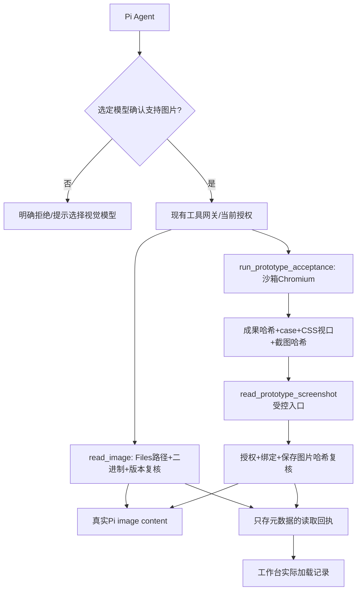

# 授权图片与原型截图接入（阶段2）

2026-10-07。此阶段在阶段1授权技能通过后实现，范围是让真实 Pi Agent 读取授权目录图片及原型验收截图。不更换模型、不修改用户资料、不恢复先前暂停的业务原型修订。

## 行为与边界

现有用户图片附件链路保留；新增 `read_image({mountId,path,expectedContentHash?})` 用原始二进制读取授权 PNG/JPEG/GIF/WebP，经文件大小、图片结构、路径、当前权限及前后版本复核，再由 Pi 原生 read 工具形成 image content。图片不经过 UTF-8 文本适配。目录索引提示图片需此工具与已确认的视觉模型。

模型的真实配置必须 `supportsVision===true`。未知或纯文本模型明确返回 `MODEL_VISION_UNAVAILABLE`，要求选择已配置视觉模型，不静默路由。工具存在不代表当前 DeepSeek 或其他供应商模型已确认能看图。

`run_prototype_acceptance` 继续执行真实受控 Chromium DOM/交互验收，并返回每张截图的 `read_prototype_screenshot` 受控入口。读取必须同时匹配 report、screenshot、成果 entryHash 和 caseId，验证保存图片哈希及授权范围，返回真正 image content。回执绑定 executionId、case、CSS viewport 与来源版本；历史截图可读取但明确标为 stale，不冒充当前成果。旧截图若缺可验证哈希，需重新验收。

普通 operation 日志、Run 与 ContextManifest 只保留图片路径、尺寸、字节数、哈希、时间和绑定元数据，不写入 base64 正文。Pi 原生会话上下文按其原生图片机制保存 image content。Plan 可以只读图片/已有截图，不因此获得执行脚本或运行原型验收的权限。

隐藏原型窗口的 CSS viewport 通过 CDP metrics 设置并实测 `window.innerWidth/Height`。截图使用 `capturePage({stayHidden:true})`；Windows 显示缩放可能给出物理像素，原始尺寸保存在 capture 回执，保存 PNG 用 NativeImage.resize 归一化到 CSS viewport。这是有记录的归一化，不宣称原生捕获一开始就是 CSS 尺寸。

## 代码与流程

核心代码：`main/image-reading.ts`、`shared/image-reading.ts`、`main/prototype-acceptance.ts`、`main/prototype-browser.ts`；工具桥接及回执展示分别接入 `main/agent.ts`、`main/service.ts`、`src/App.tsx`。截图 capture 元数据在 `shared/prototype-acceptance.ts`。

独立图源：`docs/diagrams/authorized-image-reading.mmd`。

## 已完成验证

- `npm run check`、`npm run build` 通过；build 只有既有 Vite 大 chunk 提示，未打包。
- `tests/image-reading.test.ts` 4 项专项覆盖真实二进制与 Pi 图片返回、无视觉能力/撤权/哈希冲突/损坏图片/外部链接/取消、原生本地 HTTP tool 回合进入下一轮 image_url、截图成果/case/hash/视口绑定及 stale/revoke/tamper。与 skills、prototype-acceptance、runtime-model-images 合计 34/34 通过。截图 domain 单测使用契约 runner，真实浏览器另列如下。
- `tests/test-profile.test.ts` 1 项验证隐藏开关必须明确启用、绝对测试子目录、根目录/前缀兄弟/相对路径/外部 junction 拒绝。默认正常应用窗口不变。
- `node scripts/prototype-viewport-smoke.mjs` 真实 Electron 6 检查通过：390 宽492溢出确实判失败、35px触点失败/44px成功、真实可信点击、同文件手机失败桌面成功、旧用例、网络阻断。证据 `.test-data/prototype-viewport-smoke-QWOGgZ/report.json`，阻断服务收到0请求。
- `node scripts/authorized-skills-images-smoke.mjs` 官方 IPC send + 真实 Pi + 确定性本地 HTTP + 真正 Electron/Chromium 集成6项通过。证据 `.test-data/authorized-skills-images-CdEheE/report.json`。本地7请求：视觉模型5回合图片数0/1/1/2/3，纯文本模型2回合始终0。工作台 DOM核对发现1、实际加载1、非法技能诊断、图片hash及390/1440 CSS视口；renderer无错误、全部窗口保持隐藏、合成参考/原型hash未改，结束后测试专属进程已退出。

实际截图（已人工查看）：`.test-data/authorized-skills-images-CdEheE/prototype-mobile.png`、`prototype-desktop.png`、`prototype-medium.png`、`workbench-evidence.png`。手机图显示可信点击后的“已分配”，桌面图显示独立新用例“未分配”；三个44px控件无水平溢出。工作台截图显示技能及发现问题，其余图片/加载回执通过同一界面DOM核对。原生捕获依次为537×1161、1980×1238、1760×1100，保存图归一化为390×844、1440×900、1280×800，元数据完整保留。

## 失败记录与限制

首次 `.test-data/prototype-viewport-smoke-JsuPdP/report.json` 实测390/492溢出正确，但隐藏窗口 CDP `Page.captureScreenshot` 触发 `PROTOTYPE_STEP_TIMEOUT`，无截图使结果 unknown。修正恢复 stayHidden 原生捕获，不扩大3秒步骤超时，后续真实测试通过；保留首次失败证据。

首次组合桌面启动器 `.test-data/authorized-skills-images-FwQWwd/hidden-bootstrap.cjs` 尝试重新定义 Electron BrowserWindow 导出，触发“Cannot redefine property”原生错误弹窗。已停止该测试实例，改为生产入口明确测试路径限定开关；bootstrap先注册安全异常记录与退出、不修改Electron导出。后续隐藏启动及集成通过，不把这次失败删除或算成功。

上述集成使用合成极小界面与确定性本地模型，只证明权限、协议、图像和显示链路接通。没有云模型视觉质量验证，没有宣称旧业务原型全量验收通过，也未修改客户原型或用户 profile。

通俗解释：Agent现在可以真正看到授权文件夹里的图，也能看到自己验收原型时拍的图；工作台记录它到底读过哪一张。没有视觉能力的模型会直接说明，而不会偷偷换模型。
