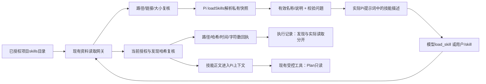

# 授权项目技能接入

2026-10-07，阶段1。用户授权顺序为技能、图片、运行中追加与排队、真实状态，最后评估分支、供应商与扩展。本页仅记录文本技能与读取桥接，不宣称后续阶段或旧原型视觉修改完成。

技能目录现在会发现、校验并描述可用技能。模型匹配任务后调用 `load_skill({name})`；用户也可发送 `/skill:name 任务`。两条路径均经现有工具网关、当前目录授权与内容哈希复核，正文只进入实际Pi上下文，Run/ContextManifest保留路径、哈希、时间、字符数和调用方式。界面区分“已发现”与“已读取”，显示发现问题。通俗地说，资料架上的说明书可以被模型按需翻开，但列出书名不代表已经读过。

## 实现与边界

- 复用Pi0.86.1公开`loadSkills`与`stripFrontmatter`；保留单一Pi运行时，没有引入LangChain依赖或第二套Agent循环。宿主目录授权、资源解析、会话上下文与运行证据保持分层。
- 仅发现已应用项目资源结构里的skills节点，以及明确启用的skills挂载。不会开启无关全局技能。保留`noSkills:true`并由宿主生成受控技能section，以适配`read_file`的挂载+相对路径契约。
- 发现先通过Files读取已授权正文，再在私有临时快照上调用Pi解析，解析后删除快照；Pi不会自行遍历项目链接或重开项目技能路径。读取前后复核授权、路径和哈希；目录撤权、工作空间切换、技能变化均不能静默继续加载。
- 无效声明、不可安全调用的名称以及同名技能阻断并显示问题；兼容Pi的非阻断warning并显示诊断。ZIP外层文件夹名称不覆盖frontmatter声明name。`disable-model-invocation`只允许用户显式加载。长描述的发现摘要截至1024字符并显示Pi警告，正文加载保持原文。
- 技能文件最多64KiB、100个候选、8层目录，超过扫描范围明确记录问题，不声称完整发现。技能引用仍通过授权工具读取。技能中的脚本不被自动执行；Plan不暴露进程/脚本/写入工具，网关也再次拒绝。
- `/skill:`由宿主受控展开；关闭Pi原生prompt模板展开，避免其直接`readFileSync`加载项目技能。`Runtime.prepareUserInput`可供后续排队/追加复用同一读取路径。
- ResourceLoader设置`noContextFiles:true`和空append来源。工作空间规则只由既有已授权AGENTS读取注入，不自动扫描应用data目录祖先。
- `read_file`保留Pi行分页。超长单行的回执不再建议不存在的bash或虚拟文件路径，而给出同一工具的真实挂载、路径、字符偏移和哈希；UTF-16字符分页最多12000字符/页，可验证续读版本。

独立源文件见[技能桥接图](diagrams/authorized-project-skills.mmd)。

## 验收证据

`tests/skills.test.ts`专项8项已通过，涵盖授权发现、描述与正文分离、显式命令、重复/非法声明、ZIP和warning兼容、撤权和哈希变化、外部链接拒绝、真实Pi系统提示、Plan工具清单及网关、Service回执持久化、长行无损续读。原生提示词测试使用确定性本地HTTP服务，核对真实Pi请求，未调用云模型。

模型按需`load_skill`的原生工具回合已通过：确定性本地HTTP返回真实tool_call，Pi调用宿主工具后将带正文和哈希的tool结果送入下一轮请求。`npx tsx --test tests/skills.test.ts tests/runtime.test.ts tests/agent-mode.test.ts`共30/30通过，`npm run check`通过。桌面可视验收将与阶段2图片链路一次集成运行；不把类型检查或本地HTTP契约测试视为真实云模型质量与桌面视觉验收。

后续阶段2桌面集成已经通过，证据 `.test-data/authorized-skills-images-CdEheE/report.json` 与 `workbench-evidence.png`。真实官方send通过 `/skill:orders` 先加载正文进入Pi请求，界面明确显示发现1/实际加载1及非法技能诊断；测试细节与失败修复记录见 `docs/authorized-image-reading-2026-10-07.md`。这是本地产品集成证据，不代表云模型质量。

大小写复核：Pi 0.86.1 原生目录 scanner 对 entry.name 使用严格 `SKILL.md` 比较；递归子目录 includeRootFiles=false，不将小写 skill.md 当技能入口。宿主保持该目录发现语义，不任意扩大到子目录普通md文件。明确传入单个md文件属于上游另一入口，不等于授权目录递归发现。
