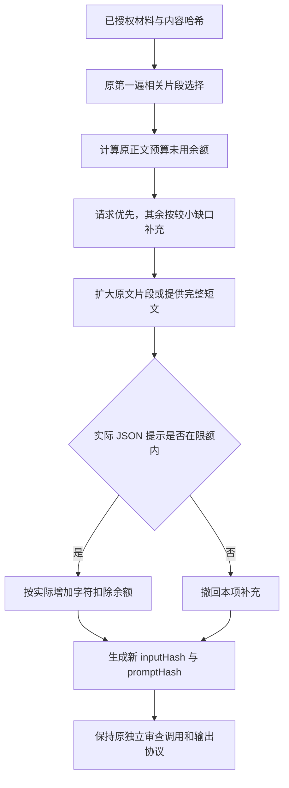

# 独立内容审查的上下文预算

审查输入只使用宿主已授权、已冻结版本的用户要求、成果和来源。正文仍受原总预算和每份材料的上限约束，最终序列化提示另受模型可用提示长度约束。

第一遍保留原来的片段选择。第二遍各份材料最多补充一次，只分配 `floor((promptLimit - overhead) / 2)` 原正文预算的未用余额；不会因为序列化提示还有空间而提高正文预算。请求优先，较小缺口在大来源前补充，同优先级使用稳定身份排序。

新增片段均为原文的真实区间，保留原已选内容、UTF16 起止位置和行号，不重叠，最多 8 个片段。请求和成果的单项正文上限仍为 16000 字符，来源仍为 20000 字符。每次补充后检查实际提示长度，超限就撤回本项补充。

全部已提供文字放入提示，不等于原件完整读取。宿主的 `readCoverage: partial` 不会升为 full；未提供的文字仍未审查。来源身份、授权、原件/正文哈希与 wire v2 引用表保持不变。上下文变化会产生新的输入哈希，旧审查回执仍可作为历史验签，对新输入则 stale。

固定回归资料使用纯合成文本，不含业务资料、真实路径、运行标识或凭据。旧输入 JSON 冻结了旧选择结果，测试无需复制旧 builder。测试检查旧输入可验签、新输入补齐短稿、原选区间保留、两种预算、partial 覆盖、真实引用与假引文拒绝。

用容易理解的话说：短报告原本得到的容量有时没用完，第二遍把这部分闲置容量再分配一次，让模型能看全短报告。总容量不变，模型的判断仍需要验证；这项改动不保证报告内容正确，也不增加输出或思考额度。
