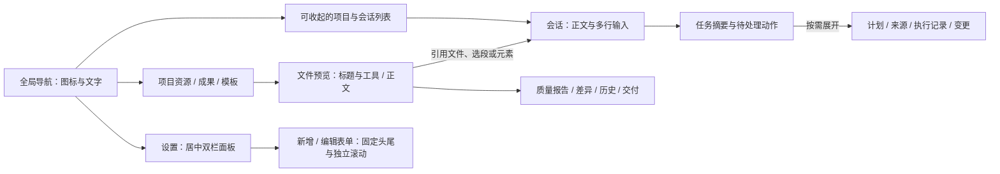

# Slash 可交付界面设计

状态：0.3.0 已实现、验收并完成 Windows 便携交付。日期：2026-10-04。本轮基于真实功能统一桌面产品的视觉与交互；0.2.1 的布局减重是历史基线，本轮完成证据见下方验证记录。

## 设计方向

受众为高频处理原型、PRD、资料和修改交付的 B 端产品经理。界面的首要任务是帮助用户明确当前项目、当前工作、可以采取的下一步。保留会话为编辑入口，资源和成果为阅读引用入口。

采用“精确的产品工作台”方向。特征是紧凑而清楚的项目导航、宽松正文、大输入区、连续的文档工作面。品牌斜线仅作为小型标记，避免海报式标题和装饰背景。

### 基础尺度

- 中文与西文正文使用应用内置 Noto Sans SC 可变字体，保留系统回退；代码使用 Consolas 等宽字体。离线运行不请求字体 CDN，随包保留字体许可和来源。
- 字级：导航/控件 13px，辅助说明 12px，会话/阅读正文 15px，页面标题 24px，空会话标题 28px；以 400/500/600 表达层级，减少粗体堆叠。
- 间距采用 4/8/12/16/24/32；按钮 32–36px、输入控件 36px，触控/图标按钮至少 28px。聊天输入保留不小于 112px 的多行编辑区域。
- 全局导航 rail 保留图标上文字下；项目列约 216–228px，加 rail 总宽 272–288px。正文最大宽度约 760–800px，窄预览情况下仍有至少 20px 文字边距。
- 颜色：瓷白 #FFFFFF、浅灰 #F6F7F8、墨色 #20242B、辅助灰 #69717D、边界 #E4E7EC、品牌铜橙 #BF5838。深色与米色主题用语义变量映射同一层级。原生标题栏和页面顶部颜色同步。
- 统一 SVG 图标笔画与视觉尺寸；图标表达真实功能，不再用 Unicode 方块、太阳或斜纹字形充当常用图标。
- 所有状态保持可分辨的悬停、焦点、选中、禁用、等待与错误；滚动条窄而清楚，动画轻量并尊重减少动态效果。

## 页面与操作规范

| 区域 | 目标 |
| --- | --- |
| 导航 | 紧凑品牌；新会话和搜索易发现；项目分组稳定；支持显式收起项目列并保留图标文字 rail；右键、归档设置、文件导入保留 |
| 会话空态 | 清楚的标题与四个轻量工作起点，包含动作和简短用途；有模型配置问题时给真实修复入口 |
| 已有会话 | 清楚区分用户内容、助手正文、执行摘要和待处理事项；无装饰性大卡片与重复成功标签 |
| 输入 | 边界明确、正文宽松、底部操作分组；引用/工作流、模型、模式权限之间有可读区分；窄窗自动换行 |
| Run/审批/变更 | 摘要紧凑，来源日志可展开；真实待确认、拒绝、失败和未知结果不能隐藏 |
| 资源/成果 | 顶部项目上下文与数量、真实搜索、清晰目录/文件列表、类型图标与行操作；打开、引用、定位、右键完整保留 |
| 预览/差异 | 文件名仅出现一次，标题与工具控制在两层；版本清楚；质量和差异报告摘要先行，问题完整保留但按需展开；选择报告动作后关闭更多菜单 |
| 设置 | 居中的有边界双栏面板，左侧分类、右侧分组表单；模型、权限、连接、目录、归档、任务同套规范；子表单完整可见 |
| 引用/弹层 | 清晰搜索和选中状态、固定确认区域；锚定菜单不漂移；Escape 和焦点返回符合层级 |
| 共享/模板 | 使用同一页头、表单、状态与按钮规范，保留真实系统检测与高级配置，不新增伪状态 |

## 完成条件

1. 上述页面以当前真实源码完成统一设计，不仅美化空会话。
2. 每类页面检查空、已有数据和至少一种关键交互状态；会话额外验证运行、待确认、失败与变更。
3. 三主题、常规/窄/大窗口无主界面横溢，输入框与主要操作可用；实际截图人工审查字体、比例、图标、层级一致性。
4. 项目隔离、真实模型选择、权限、Plan/Build、来源、版本、ChangeSet、交付门禁不退化。
5. 类型/单元/真实 Electron 工作流及界面回归通过；测试结果不得替代审美审查。最终 Windows 便携应用直接启动和退出通过。
6. 文档、来源许可、版本和可交付产物一致。外部 CLI/MCP/SMB 的真实联调边界沿用既有记录，不因界面完成而声称已验证。

源码备份：`.dev-backups/before-delivery-ui-20261004.zip`。代码由 GPT-6.1 Sol / High 子代理实现，主代理负责设计与最终验收。

字体来源：[Google Fonts Noto Sans SC](https://github.com/google/fonts/blob/main/ofl/notosanssc/NotoSansSC%5Bwght%5D.ttf)，许可见同目录 OFL.txt。须下载并核对实际文件后纳入分发。

## 界面协同图

此图仅说明 UI 组织；Pi、权限网关、文件版本和外部交付边界继续沿用现有系统。

## 验证记录

最终聚合验收见 `.test-data/delivery-ui-acceptance-20261004/result.json` 和同目录 `verification-record.md`，保留完整矩阵原始失败与针对性补验的对应关系，不用聚合结论覆盖原始报告。

- 实现代理执行 `npm run check` 通过，主代理统一执行 `npm run build` 通过，日志 `.test-data/delivery-ui-build-final.log`。构建仍有超过 500KB 的 JS chunk 提示，本轮未做代码分包优化。
- `npm test`：130/130 通过，日志 `.test-data/delivery-ui-tests-final.log`。包含新补的连接发现契约回归：UI 官方 CLI 候选不混入手动 MCP，Pi 工具仍能读取合并后的连接列表。
- 真实 Pi 工作流：10/10 通过，证据 `.test-data/pm-focus-1791049675430/result.json`。使用隔离目录和本地确定性模型，包含资料读取、工具草稿、来源回执和重启恢复；不代表云端模型质量评测。
- 首轮人工复核发现并修复长表单标题挤压、引用文件行居中、搜索图标叠字、连接发现页面崩溃等问题。失败截图与结果保留用于诊断，不计入最终通过证据。
- 独立视觉复核实际审看冻结版本 34 张代表截图，覆盖三主题及 1101×761、1368×901、1602×1001 窗口，未发现所审状态中的视觉交付阻断，详见 [独立审计](delivery-ui-audit-20261004.md)。主代理另复核最终打包版空会话、窄设置及实际便携启动截图。
- 最终打包目录完整矩阵：三主题 × 三尺寸共 9 组，857 条检查通过、0 页面错误、460 张截图，18 次本地确定性模型请求。证据 `.test-data/delivery-ui-packaged-1791050211197/result.json`。运行、审批、权限实际保存与选中样式、引用、文件、预览、长表单、8 个设置分类、模型新增编辑和归档删除均通过。此原始报告仍保留 1 条连接方式控件的测试定位失败，不伪造为全绿。
- 定位失败的原因是原生 select 的可访问名称包含选项文字，测试错误使用 exact label 匹配；仅修复测试选择器，产品源码与包不变。针对末尾设置操作执行 `--packaged --settings-save-only` 补验，3/3 通过、0 页面错误：模型新增编辑和密钥保留、停用 MCP 连接新增编辑并核对真实保存值、归档删除。证据 `.test-data/delivery-ui-packaged-1791050565030/result.json`。测试前后 exe/app.asar SHA-256 一致。
- 实际字体字形由 CDP 确认为内置 Noto Sans SC，自定义字体加载成功；原生窗口背景与页面标题区在三主题下对应一致。没有修改用户日常资料、模型密钥或外部系统。

## Windows 交付产物

- 已冻结构建通过 `npx electron-builder --win portable --x64` 打包，退出码 0；日志 `.test-data/delivery-ui-pack.log`。
- 便携版：`release/slash-0.3.0-portable.exe`，187,214,476 字节；SHA-256 `ded2870df9d74f6a677b2ab049371a0098f4060c597d0f5e7e0852118a71a74f`。同目录保存校验文件和 `build-info.json`。
- 直接启动最终便携 EXE 通过，品牌窗口、IPC、加密测试模型配置读取与正常退出均通过，退出码 0；证据 `.test-data/delivery-ui-portable/result.json`。使用隔离测试配置，没有调用云端模型。
- 从实际 EXE 提取 Windows 图标并人工比对通过，unpacked 与便携版均为铜橙 Slash 品牌，证据 `.test-data/packaged-icons-20261004-015722-395/`；不只依赖配置中的 icon 路径。
- 从最终 `app.asar` 核对完整字体、许可和品牌资源存在，字体字节数及 SHA-256 与源文件一致，证据 `.test-data/delivery-ui-packaged-assets.json`。最终 exe / app.asar 在便携压缩前后 SHA-256 一致。
- 开发入口保持根目录 `双击启动开发环境.bat` 或 `npm run dev`。0.2.1 便携版与本轮前源码备份继续保留。

本轮验证覆盖本地产品界面与应用流程；没有创建真实飞书/钉钉文档、调用生产 MCP 发布或建立双机 SMB 共享。外部渠道的真实集成验收边界继续沿用已有记录。
