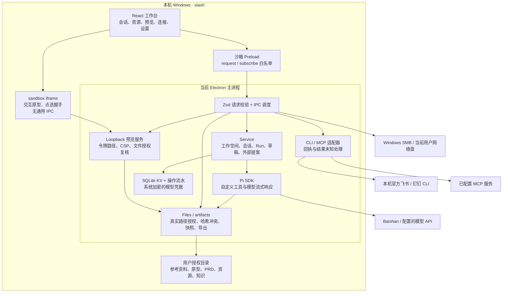

# 当前可运行实现架构

日期：2026-09-21。此图描述已打包验证的基础版本；目标架构仍见 architecture-baseline.md，功能缺口见 feature-coverage.md。

2026-10-07 补充：当前 Agent 接入边界、LangChain 设计参考及代码核实的缺口见 [Agent 架构检查与 Pi 接入修复](agent-architecture-review-2026-10-07.md)。下方是历史基础图，不应据此推定所有目标模块已经实现；新增能力的完成情况以增量验收记录为准。

当前的进程边界：React 渲染进程与主进程分离；原型运行于受限 iframe。业务服务、Pi 运行时、文件解析和预览 HTTP 服务仍在 Electron 主进程内。因此不能把目标架构中的独立 Agent 工作进程、独立预览 WebContents 或解析进程隔离标记为已实现。

目录权限在每次工具操作时校验，逻辑分组不赋予目录权限。模型只获得显式自定义工具；外部文档写入先生成提案，界面确认后执行，并核对源文件哈希。模型回复、工具调用记录、草稿和外部回执分别保留，不以聊天中的“成功”代替运行状态。

凭据不放入工作空间或分发包。正式配置位于当前 Windows 用户的 `%APPDATA%/slash`；测试通过单独 profile 运行。
