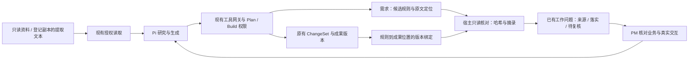

# 业务规则与成果落实核对

状态：源码、全量测试、开发及打包桌面验收通过，已交付 0.3.8 便携版并直接验证 EXE 启动与退出。真实云模型业务验收尚未执行。

## 要解决的工作问题

PM 修改 PRD 或原型时，除了知道文件改过，还需要知道所依据的业务规则来自哪里、在哪些成果里有落实位置、哪些位置在修改后需要重新核对。本轮把这条链路放进已有的需求和工作问题记录，不新增独立中心或强制填写的表单。

真实资料复核说明了这一点：同一份网点字段表的两个工作表都有“网点编码”，但终端网点和机会门店的编码前缀、新增展示规则不同。仅保存文件名或关键词会把不同对象的规则混在一起。验收草案已纠正，见 [业务验收场景](pm-business-acceptance-scenario-2026-10-05.md)。

## 契约与边界

在现有需求记录中增加可选的规则与落实引用，已有需求和普通产物继续可用。

- 规则记录字段/对象、独立维度、资料原值、适用阶段、候选解释，以及包含完整原文摘录的来源定位。必填、仅正式落库、新增展示、允许变更分别记录，不从其中一项推导另一项。
- 来源引用绑定宿主读取的实际文件哈希；工作表与单元格名称保留在定位说明中。UTF-8 提取文本的行段可由宿主核对，不能据此宣称已独立验证原 Excel 单元格含义或原材料权威性。
- 落实引用将一条规则关联到 PRD、HTML 等成果的实际内容哈希、位置及摘录。宿主核验实际内容，模型不能自行指定一个“通过”结果。
- 只读核对区分版本有效、版本已变化、未定位、未关联、无法读取。版本有效只表示已保存的证据与当前文件匹配，业务正确性仍需人工或真实交互验收。
- 保留旧落实记录。成果改变后显示需要复核，不悄悄用新哈希替换旧证据。重新绑定同一规则与成果时核对最新绑定，旧版本可追溯。规则修正使用同字段、同维度、同阶段的候选替代链，不能借此确认业务正确或改变目录权限；Plan 不能写规则或绑定关系。

来源原件仍只读。需要处理的 Office 文件先生成登记副本并提取，沿用 [资料提取与检索](pm-evidence-foundation-2026-10-05.md) 的链路。

当前核对的是规则记录直接引用的文本文件及成果版本。如果记录引用提取文本，“版本有效”不会自动证明其原始 Office 文件从未变化，也不会推定该材料已正式生效。原件到副本的处理回执与本次规则绑定分别保留，需要更新来源时重新读取、提取并建立替代候选。本轮不把哈希核对包装成语义或制度有效性判定。

后续 0.3.9 补充：对于有登记回执的处理输出，会额外核对原件与处理副本的字节版本，详情见 [原始资料版本核对](source-freshness-2026-10-05.md)。上段保留为 0.3.8 的边界；资料权威性、业务语义以及未登记或多层转换来源仍不能由哈希自动确认。

## 用户操作

在会话要求 Agent 整理关键规则，记录资料依据并关联成果位置。相关需求的“规则与落实位置”默认收起；展开后才核对当前版本，可重新核对、阅读来源、打开成果或回会话补充。

规则属于候选或未知，不因为系统找到原文就显示“业务正确”。没有建立映射时明确显示缺口。版本变化时显示旧绑定版本和当前版本，提示 PM 检查修改影响。

## 协作结构

独立图源：[pm-business-trace.mmd](diagrams/pm-business-trace.mmd)。



Pi 继续承担上下文和执行循环，没有新增 harness。数据复用产品记录、版本及权限服务，不新增独立数据库。只读核对结果不能冒充业务质量评分或正式发布授权。

## 已落地接口

- `record_business_constraints`：在已有需求上追加候选规则或同字段、维度、阶段的替代候选；源摘录须通过宿主真实读取核验。
- `bind_business_implementation`：把规则绑定到已保存的 UTF-8 文本、Markdown 或 HTML，宿主计算实际哈希。草稿须先应用，再绑定正式文件。
- `check_business_rules` / `businessRuleCheck`：只读核对，默认每页 20 条、最多 100 条，按 `nextOffset` 继续读取，返回 `total` 与本页状态。每处摘录预览最多 1,000 字符，单次输出预算 512,000 字符；读取最多 64 份文本，正文和定位预算各 8 MB，单条定位最多 100,000 字符。

IPC 示例（ID 由当前项目实际记录提供）：

```json
{"type":"businessRuleCheck","requirementId":"实际需求ID","offset":0,"limit":20}
```

核对只按用户展开或再次点击触发。规则修改工具仅返回新增 ID、数量及后续查询提示，不把整份需求和历史原文反复注入 Pi。文件路径别名统一比较；取消、项目切换、授权变化和提交前的内容变化会拒绝新增记录。

## 验收清单

| ID | 必须验证 | 当前证据 |
| --- | --- | --- |
| BTR01 | 四种维度分别保存，未知不升级、旧记录兼容 | business-rules.test.ts、product-records.test.ts |
| BTR02 | 虚构摘录拒绝，来源或成果修改显示陈旧；不能传 passed | business-rules.test.ts、business-rules-runtime.test.ts |
| BTR03 | 显式落实关系用于当前成果问题和影响，其他项目不能混入 | business-rules.test.ts、delivery-gate.test.ts、桌面路径及新会话绑定用例 |
| BTR04 | Plan 不写、撤权不可读、原件不改 | 真实 Pi 本地 HTTP 两用例、撤权及取消回归、Office 桌面验收 |
| BTR05 | 折叠查看、重新核对、来源和成果入口、窄面板可用 | 业务规则 Electron 13 项与截图 |
| BTR06 | 真实模型生成机会门店 PRD / HTML 并完成业务与交互核对 | 待模型配置及实际运行 |

单元测试、HTTP 模型夹具和桌面操作只证明契约及流程。业务验收按修正后的来源预期独立进行，不能用模型自评或静态 HTML 结构检查替代。

## 当前测试证据

- `npm run check` 与 `npm run build` 通过：`.test-data/business-trace-check-final.log`、`.test-data/business-trace-build.log`。前端包仍有原有的 500 kB 提示，本次约 713 kB，构建成功。
- 全量 `npm test`：**250/250**，46.3 秒，`.test-data/business-trace-tests.log`。包含 10 个业务规则测试和 2 个实际 Pi 工具链测试。
- 实际 Pi Build 经本地 HTTP 四轮调用记录规则、绑定位置、核对规则后结束；Plan 经两轮完成只读核对，工具清单和宿主均拒绝写规则。测试文件 `tests/business-rules-runtime.test.ts`，这是合成模型响应，不是云模型业务验收。
- 新功能 Electron **13/13**，页面错误 0：`.test-data/business-rules-ui-1791156805477/result.json`。主代理独立查看 `prd-current.png` 和 `source-revoked.png`；包括路径别名、没有 artifactId 的路径绑定、新会话关联、旧规则替代、重新绑定、窄面板和撤权后的正文隐藏。
- 原工作区桌面回归 **14/14**：`.test-data/workspace-ui-development-1791156942722/result.json`。Office 专项 **6/6**：`.test-data/office-processing-ui-development-1791156988151/result.json`。均沿用真实 Service、Pi 与隔离测试资料。
- 首轮新功能 GUI 的前 7 项通过后，测试脚本误以为再次浏览成果会自动回到顶层目录。保留失败记录，仅修正脚本导航后完整通过。之后为增加截图启动的附加运行已主动停止，没有计为通过；正式证据以上述 13 项为准，没有残留测试 Electron 进程。

## 0.3.8 打包交付

交付文件：`release/slash-0.3.8-portable.exe`，189,058,275 字节。SHA-256：`b7da2584dd1141193f9161e326cc5f3b711eda95bb94111c06378a6e19d44de7`。构建元数据在 `release/build-info.json`，旧版 EXE 保留。

最终构建及打包成功，日志为 `.test-data/pm-038-build.log`、`.test-data/pm-038-pack.log`。以下 41 项针对同一个 `release/build-0.3.8/win-unpacked/slash.exe`，使用隔离资料和本地模型夹具：

| 检查 | 结果 | 证据目录（.test-data 下） |
| --- | --- | --- |
| 业务规则界面 | 13/13，实际版本 0.3.8 | business-rules-ui-packaged-1791157257813 |
| 工作区、回复、模式、目录与恢复 | 14/14 | workspace-ui-packaged-1791157306544 |
| Office 副本提取及原件不变 | 6/6 | office-processing-ui-packaged-1791157344305 |
| 模型容量来源、手动覆盖及重启 | 8/8 | model-limits-packaged-1791157367517 |

各目录含 `result.json` 和截图，页面错误均为 0。主代理另查看打包版的维度截图，确认“仅正式落库”没有被混同为“必填”。测试前后 EXE 和 app.asar 哈希不变，记录为 `pm-038-binaries-before.json` / `pm-038-binaries-after.json`。

直接启动最终便携 EXE，通过主窗口、IPC、隔离夹具的加密模型配置恢复及正常退出检查，wrapper 退出码为 0。证据：`.test-data/pm-038-portable/result.json`。此检查没有使用用户项目或云模型凭据，不代表用户实际模型连接已验证。

## 真实资料验收准备

只读来源核验脚本 `scripts/pm-business-evidence-review.mjs` 将工作表和单元格绑定到固定预期，再生成待人工填写的成果对照表。2026-10-05 的本地来源断言 29/29 通过，证据为 `.test-data/pm-business-source-review-2026-10-04T23-20-16-544Z/source-business-assertions.json`。这 29 项包括来源版本及资料记载的值，不是 29 项模型业务任务通过。

`scripts/pm-business-real-baseline.mjs --prepare` 仅建立隔离测试目录，选择性复制模型配置和资料副本，不恢复用户项目、会话或任务。只有显式运行 `--run --allow-cloud` 才会调用配置模型。真实模型执行复用当前构建中的 Service、Pi、权限和 ChangeSet，不新增产品执行框架。

目前找到的默认模型配置没有可用密钥，因此真实云生成未执行。测试准备保留原件哈希、完整提取文本、机会门店工作表片段、模型能力来源及待人工审核表；不能把准备成功记为 PRD 或原型业务验收通过。工作表片段是人为选定的测试输入，本场景不用于衡量自动选表的准确率。
