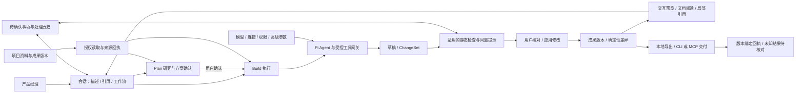

# Slash 个人 PM 版本：范围与交付验收

2026-10-13 F02/F03/F10、PF03/PF05/PF08/PF09：会话添加文件支持PDF/DOCX/XLSX/PPTX与常用文本/代码，真实正文经原附件快照与Service上下文进入所选模型；图片视觉链保留。多选/拖入/文件粘贴、单项失败重试移除、预算截断与历史重启、运行中附件队列阻断已验证。38项定向及9组真实Electron本机协议通过，错误显示补充验证；云模型/系统剪贴板边界、schema及限制见[文件上下文交付](file-context-attachments-2026-10-13.md)及同名Mermaid。需重启开发应用，未打包。

2026-10-13 F02/F10、PF03/PF08/PF09：回复底部两个重复入口移除；实际执行状态以答复前的单Run紧凑步骤显示，诊断折叠，普通完成招呼无空卡。工作记录集中到会话顶部，保留完整项目历史、问题处理和原数据；活跃任务优先排队且各自归属。check/build、16项定向与隔离UI证据及真实集成边界见[本轮交付](chat-execution-cards-2026-10-13.md)和同名Mermaid。未打包。

2026-10-13 F02/PF10 最新用户要求：启动动画、预览与相关设置退出当前产品；主窗直接显示，保留真实加载失败/崩溃恢复和隐藏测试。模型保存事务、Escape保护及开发启动租约/Vite清理保留；用户偏好与SQLite不删除迁移。代码、隔离验收及边界见[移除记录](startup-animation-removal-2026-10-13.md)及同名Mermaid。

2026-10-13 PF03/PF09/PF10：修复模型落盘失败重试、保存中Escape及部分失败草稿丢失，真实模型UI脚本按主窗URL选窗；Windows开发启动防重复编译并监督Vite后续存活。check/build、61项定向和8组真实模型UI通过；隔离BAT基线超时，不声称稳定提速或原生偶发问题已根治。见[实现与边界](model-save-and-dev-startup-reliability-2026-10-13.md)及同名Mermaid；未打包。

2026-10-13 PF03/PF09/PF10/PF11：移出无活跃调用的旧云知识库发布依赖，完整本机归档并保留数据兼容/退休入口拒绝回归；资料集合与原文检索不变。源码、启动和构建摆脱旧网页目录，实际检查及远端未操作边界见[退役源码清理](knowledge-source-cleanup-2026-10-13.md)和同名 Mermaid。

2026-10-13 PF03/PF09：模型配置支持多个独立 ID 输入框、添加/移除行，按上游连接获取目录成功后逐行下拉选择；同供应商复用连接与宿主密钥引用，批量新增重复项不覆盖旧配置。详情及本轮验收边界见[模型列表与批量添加](model-discovery-and-batch-add-2026-10-13.md)和同名 Mermaid。

2026-10-13 PF03/PF08/PF09/PF10：输入底部紧凑分组、固定主按钮、子 Agent 中文开关与聊天顶部待处理队列；运行中默认排队，保留编辑取消及单条立即发出。关窗毁窗通知及重复清理修复后，真实活动队列自然退出0、原文取消保存通过。实际 1366/680/390 与原 Pi 接续语义、检查及未验证项见[交付记录](composer-toolbar-and-queue-2026-10-13.md)和同名 Mermaid；需重启开发应用。

2026-10-13 PF01/PF03/PF08/PF09：资源、成果、设计体系、测试用例首屏工具区压紧；会话正文14/22、标题20/28、辅助12，对照本机Codex基础规则。实际Electron的1366/1920 CSS viewport、列表提前量、保留功能及未验证项见[交付记录](compact-workspace-typography-2026-10-13.md)与同名Mermaid；原型和文档字号边界保留。

2026-10-13 PF01/PF08/PF09：设计体系185来源图片、3项明确无图，列表/大图/来源入口/失败状态及390px已验证。check/build、图片专项2项和既有引用链8项通过；系统浏览器实际打开、全152图人工检查及真实模型质量未新增验证，详见[交付与边界](design-preview-source-images-2026-10-13.md)及同名Mermaid。未打包，需重启开发应用。

2026-10-12 PF03/PF05/PF09/PF10 最新验收：Subagent 使用列表→新增/编辑独立页，名称/用途/模型/思考/提示词真实按 agentId 生效；旧单配置无损迁移，未知 ID 拒绝，两项模型/指令隔离，预算按 Run 共享，composer 只改全局 enabled。UI包含保存失败保留草稿、未保存返回提示、能力/失效状态和窄窗。实际检查与局限见[Subagent 记录](subagent-settings-2026-10-12.md)及同名 Mermaid，覆盖下方旧单项与旧命名。

2026-10-12 PF01/PF03/PF08/PF09 最新取舍完成：左侧独立“设计体系”主页面取代右上和右侧窄栏入口，保留188参考的搜索/筛选及集合卡，应用回原会话不丢未发内容。Slash只移除四项PM提示词预设及隐藏解析，真实skills、plan/help与原业务工作流保留。check/build、12项定向、11组设计/命令UI、六组真实skills UI通过，独立桌面图审通过；窄屏隐藏侧栏和模型质量/发布未新增验证边界见[交付记录](design-navigation-and-command-cleanup-2026-10-12.md)及同名Mermaid。未打包。此条覆盖下方旧右侧设计入口约定。

2026-10-12 PF03/PF05/PF09：完全访问目录浏览/读取沿现有电脑scope补齐绝对directory隐式绑定、浅层子目录及已登记子directory范围，子Agent仍经父实时网关。60/60定向与check/build通过，真实本机Pi父/子及旧IPC路径验收，标准/自动拒绝、Plan只读与原保护保留；无云模型效果/新桌面截图/SMB双机验收，未打包。见[本轮目录修复](full-access-directory-browsing-2026-10-12.md)及同名Mermaid。

2026-10-12 PF03/PF08/PF09/PF10 用户新增优先项：完成[子 Agent 独立设置](subagent-settings-2026-10-12.md)及[右侧设计体系与模板陈列](design-systems-delivery-2026-10-12.md)，流程见同名 Mermaid。验收包括新任务实际采用指定子模型、停用委派、设置持久化，以及“应用”后输入/历史有色描边集合卡、可信注册ID加载、Plan/恢复与版本冲突保护。设计资料只作当前任务参考，不能强制把PRD转成HTML；云模型成果质量、外部发布与SMB双机不由本机协议/UI通过推定完成。最终集成检查另由统一负责人记录。

2026-10-12 PF10：用户最新默认5173双击确认窗口可用；原 `0xC0000409` 原生退出根因仍未证实。新增同步阶段日志及BAT失败定位提示，21/21定向与check通过，隔离旧截图不作视觉通过，见[启动诊断交付](dev-startup-native-diagnostics-2026-10-12.md)及[mmd](dev-startup-native-diagnostics-2026-10-12.mmd)。

2026-10-10 用户新增优先要求：原型UI只保留业务内容与必要反馈，不显示演示/非实际产品/后台与接口限制等制作注释；实现边界在Slash交付说明中如实记录。旧元说明断言依明确需求变更另存新版，业务规则不删；实际体验和设计质量仍须新稿证明。见[产品质量审查与改进目标](prototype-product-quality-audit-2026-10-10.md)。

2026-10-10 新验收：QE12从保留稿限定修正V3/V4，Astra单次264.665秒自然完成，宿主3/4与冻结业务9/88分别通过；新稿独立23/202通过，主代理实际看8张图，原七项界面目标限定通过。40ID、业务JS与57控件/option保持；正式任务仍needs_human，内容partial与手机提示换行候选保留。隔离交付v2已通过同版本应用、历史读回、应用后回归、导出及过期版本拒绝，原启动失败证据保留；用户最新指出整体设计感与实用性仍不足，七项限定通过不能作为整体质量合格。QE05同稿新选段审查86.584秒正常结束，1有效/1结构无效，原业务violated不变；安全格式诊断已实现、待根集成；原型Agent的任务导向设计与体验审查已成为当前重点。见[原型实际证据](qe12-astra-full-visual-validation-2026-10-10.md)、[文档审查限制](qe05-independent-validation-2026-10-10.md)。整体目标active，16基准及外部验收未全部完成。

2026-10-10 PF08/PF10：原生折叠可见性、宿主/冻结回归独立执行及旧检查器证据失效已实现；通用文本审查选段保留标题背景，原预算与引文校验不放宽。根186项定向、check/build、真实编译版3/4+9/88与说明2/30通过，见[可见性](prototype-native-visibility-2026-10-10.md)、[分批及版本](task-host-check-baseline-separation-2026-10-10.md)。QE05正式业务评分仍violated，标题补齐只证明输入改善，见[实测限制](qe05-independent-validation-2026-10-10.md)。QE12剩余V3/V4继续按全部七项目标及原业务标准验收；未打包、未将局部pending作为完整交付。

2026-10-10 PF08/PF10后续修复完成：Responses默认公开compat令工具明确strict:false，既有显式配置优先；草稿回执返回实际所属Run。原权限、CAS、owner和来源检查不变。真实单次参数格式验证通过、根106/106及check/build通过，详见[参数契约](task-tool-input-usage-2026-10-10.md)、[owner契约](draft-owner-receipt-2026-10-10.md)。复杂任务和视觉质量仍须用保留部分稿完成剩余要求后分别验收，不将单次{}或本机回归当成业务通过。

2026-10-10 PF08/PF10实测更新：完整QE12在原600秒测试上限取消，部分pending保留；同稿原15/150及六状态22步全部通过，独立看图仅V1/V3/V5通过、V6部分、V2/V4/V7未完成，未apply/export、未最终云图审，见[验收边界](qe12-astra-full-visual-validation-2026-10-10.md)。v3 PRD审查异常断流仍unverified。20次查询参数错误证明最小调用提示尚未充分解决真实问题，正隔离核验Pi公开Responses兼容选项；本机通过、真实调用成功和业务通过继续分别记录。

2026-10-10 PF08/PF10质量修复：独立审查意见须明确范围/处置，范围外/不确定/仅记录不进入自动修稿，旧证据可读；三图审查优先不同现有视口，任务查询与基准代理继承补齐。124项定向、check/build通过。详见[范围](content-review-repair-scope-2026-10-10.md)、[视觉选择](prototype-screenshot-selection-2026-10-09.md)、[工具调用](task-tool-input-usage-2026-10-10.md)。真实语义与完整视觉验收继续执行，模型自评不构成用户确认。

2026-10-10 PF08/PF10、QE12最新增量：用户指定Astra已设默认并实测文字/图片输入；PRD同输入真实审查完成并独立核对两条准确提示，交付限定说明修订副本；SFA真实自动局部CSS修改经原10/77、新7/46/24和版本导出保护通过，7张实际截图经主代理复核。参见[模型](wangshu-astra-validation-2026-10-10.md)、[PRD](prd-review-real-diagnostics-2026-10-10.md)、[SFA](sfa-focused-automatic-revision-design-2026-10-10.md)。本轮证明上述明确范围，整稿业务、跨成果及真实外部渠道仍保留未验证。

2026-10-10 PF03/PF08/PF09/PF11、QE12续作：[原型交付可靠性](prototype-delivery-reliability-2026-10-09.md)已集成，check/build和90项合并回归通过。静态/运行诊断与导出保护不等于业务及视觉合格，真实云模型生成仍未验收；启动仅确认减少冗余入口扫描，不声称整体速度稳定提升。

2026-10-09 最新范围：用户要求移除云知识库。云发布、独立问答及专用向量配置/构建/查询/导出已退出当前产品；资源中保留资料集合与有效历史索引查看，普通会话原文检索和项目备忘保持。已有数据、加密凭据及远端部署未删除，云403与问答验收不再列为开发待办。实现、边界及验证见 [云知识库移除与向量取舍](knowledge-retirement-2026-10-09.md)。本条优先于下方历史记录。

更新：2026-10-02。状态：本轮个人版交付完成。128 项自动测试、10 组打包桌面回归、开发启动与便携 EXE 启动退出均通过；外部渠道和双机共享尚待真实环境联调。完整验证记录见 [交付说明](pm-focus-release-notes.md)。

## 范围依据

用户已授权依据本轮公开资料研究与建议，删除、减重原有功能并添加相关功能，持续推进到可交付。该授权替代历史文档中“全部 F01—F19 均不可删减”的范围约束。既有数据与必要权限保护保留。

调研与证据边界见 [需求证据与功能取舍](../exa-results/pm-agent-priorities-2026-10-02.md)。重点是 B 端 PM 的可交互 HTML 原型、上下文 PRD、真实资料研究，以及修改后的交付。没有统计证据证明某项功能完全无用，也不以菜单数量作为专业程度。

## 本轮产品取舍

| 分类 | 修改 | 必须保留 |
| --- | --- | --- |
| 主工作区 | 会话、资源、成果，设置留在底部；去掉独立评审、决策、流程图与知识库入口 | 项目隔离、稳定的项目/会话顺序、历史会话、归档与删除 |
| 问题处理 | 当前会话/成果显示待确认事项和检查问题，可回到会话修改、查看来源与处理记录 | 状态、关联成果版本、确认人及处理历史；不能让旧阻断项无法处理 |
| 影响查看 | 默认文件与规则影响清单，去掉大型关系图布局 | 已确认、候选、失效关系与真实差异 |
| 设置 | 普通用户常用模型、权限、连接、目录与归档；编排细则放收起的高级设置 | 已保存配置、模型切换与检查、受控子任务、共享冲突保护 |
| 质量检查 | 与当前任务匹配；模块 PRD 不强制七章；普通笔记不套 PRD 标准；明确模板才严格检查必填 | 空内容、无效结构、实际版本冲突、未核对的外部结果等实际阻断条件 |
| 辅助能力 | 模板和 SMB 共享仍可直接找到；draw.io 由会话生成、成果查看 | 可写映射盘、原邀请格式、文档/HTML/流程图导出、官方 CLI/MCP 连接 |
| 新工作流 | 原型、PRD、资料研究、会议整理、原型转 PRD、变更说明 | 输入可编辑；来源真实读取和版本绑定；仍经过 Pi 与现有工具网关 |

暂不扩展团队角色、实时在线协作、跨设备同步、插件市场、大型自动化平台。CSV/Excel 深度分析留待实际数据任务验证，不在本轮创建通用 BI 系统。

## 工作流约束

- 六类工作流为可选的会话意图，不强迫普通对话选择流程。
- 原型与 PRD 可从描述开始；研究允许通过已授权工具联网。会议整理和原型转 PRD 要求相应的真实输入资料。
- 文件来源包含挂载、相对路径、可选成果身份、版本和预期哈希。执行时复核目录授权、权限策略和当前内容。
- Run 记录来源回执与截断，不重复持久化大段源文。引用内容是资料，不能授予工具或目录权限。
- Plan 只读研究，确认后 Build 才能生成修改草稿。恢复/确认携带来源版本，更改后的资料不能静默当作原方案依据。
- 变更说明基于同一文件两个真实版本的确定性差异。模型只解释改动与待确认影响，不能捏造实际差异。
- 点选原型元素和文档选段、局部修改、版本查看/恢复继续使用现有实现。

## 协同架构

没有新增 Agent harness、独立数据库或强制团队流程。Electron/Pi/SQLite/文件版本体系延续。Agent 仍在主进程运行、预览仍为受限 iframe，不能把本轮减重宣称为已实现独立进程沙箱。

## 验收清单

| ID | 必须验证的行为 | 预期证据 |
| --- | --- | --- |
| PF01 | 简化导航仍能访问项目资源/成果，展开不重排，设置始终可见 | Electron UI 冒烟与截图 |
| PF02 | 当前工作有相关问题、来源、状态和历史；无关项目不混入 | 数据契约测试、UI 冒烟 |
| PF03 | 模型与权限正常可用，高级配置默认收起且原值不变 | 设置 UI 冒烟、持久化测试 |
| PF04 | 模块 PRD、笔记不因完整 PRD 格式被阻断，明确模板仍有效 | 质量和交付门禁测试 |
| PF05 | 新工作流读取真实资料、保存哈希/版本、继承 Plan/恢复权限 | 工作流集成测试 |
| PF06 | 原型转 PRD 不猜后台规则；会议整理区分事实/待答问题/行动 | 工作流提示契约与可运行示例 |
| PF07 | 变更说明使用真实旧→新内容，错误版本与越权来源被拒绝 | 确定性差异与工作流测试 |
| PF08 | 原型点选/文档选段、独立预览滚动、大输入区与自定义选框 | Electron UI 冒烟与截图 |
| PF09 | 草稿/恢复、撤权、外部未知结果等原有保护不回退 | 完整自动测试与打包冒烟 |
| PF10 | 开发启动与 Windows 便携包可启动退出 | 实际构建、便携启动记录 |
| PF11 | 飞书、钉钉、MCP 发布及 SMB 双机能力不误报真实联调成功 | 区分契约测试和真实账号/设备验证 |

## 验收边界

自动测试能证明权限、版本、来源处理与界面路径，不能代替业务正确性核对，也不能把静态 HTML 检查当作真实交互测试。外部账号、线上发布目标和第二台 Windows 设备不足时，明确列出未验证项，不输出虚假的发布 URL 或共享成功记录。

实施前备份：`.dev-backups/before-pm-focus-20261002-183451.zip`。实施前基线：`npm run check` 通过，`npm test` 105/105 通过。
