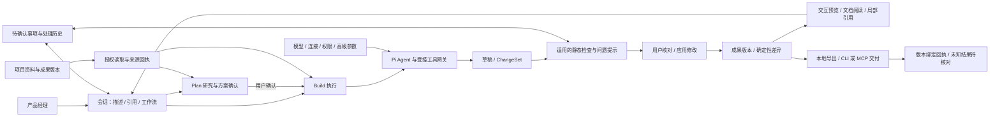

# Slash 个人 PM 版本：范围与交付验收

更新：2026-10-02。状态：本轮个人版交付完成。128 项自动测试、10 组打包桌面回归、开发启动与便携 EXE 启动退出均通过；外部渠道和双机共享尚待真实环境联调。完整验证记录见 [交付说明](pm-focus-release-notes.md)。

## 范围依据

用户已授权依据本轮公开资料研究与建议，删除、减重原有功能并添加相关功能，持续推进到可交付。该授权替代历史文档中“全部 F01—F19 均不可删减”的范围约束。既有数据与必要权限保护保留。

调研与证据边界见 [需求证据与功能取舍](../exa-results/pm-agent-priorities-2026-10-02.md)。重点是 B 端 PM 的可交互 HTML 原型、上下文 PRD、真实资料研究，以及修改后的交付。没有统计证据证明某项功能完全无用，也不以菜单数量作为专业程度。

## 本轮产品取舍

| 分类 | 修改 | 必须保留 |
| --- | --- | --- |
| 主工作区 | 会话、资源、成果，设置留在底部；去掉独立评审、决策、流程图与知识库入口 | 项目隔离、稳定的项目/会话顺序、历史会话、归档与删除 |
| 问题处理 | 当前会话/成果显示待确认事项和检查问题，可回到会话修改、查看来源与处理记录 | 状态、关联成果版本、确认人及处理历史；不能让旧阻断项无法处理 |
| 影响查看 | 默认文件与规则影响清单，去掉大型关系图布局 | 已确认、候选、失效关系与真实差异 |
| 设置 | 普通用户常用模型、权限、连接、目录与归档；编排细则放收起的高级设置 | 已保存配置、模型切换与检查、受控子任务、共享冲突保护 |
| 质量检查 | 与当前任务匹配；模块 PRD 不强制七章；普通笔记不套 PRD 标准；明确模板才严格检查必填 | 空内容、无效结构、实际版本冲突、未核对的外部结果等实际阻断条件 |
| 辅助能力 | 模板和 SMB 共享仍可直接找到；draw.io 由会话生成、成果查看 | 可写映射盘、原邀请格式、文档/HTML/流程图导出、官方 CLI/MCP 连接 |
| 新工作流 | 原型、PRD、资料研究、会议整理、原型转 PRD、变更说明 | 输入可编辑；来源真实读取和版本绑定；仍经过 Pi 与现有工具网关 |

暂不扩展团队角色、实时在线协作、跨设备同步、插件市场、大型自动化平台。CSV/Excel 深度分析留待实际数据任务验证，不在本轮创建通用 BI 系统。

## 工作流约束

- 六类工作流为可选的会话意图，不强迫普通对话选择流程。
- 原型与 PRD 可从描述开始；研究允许通过已授权工具联网。会议整理和原型转 PRD 要求相应的真实输入资料。
- 文件来源包含挂载、相对路径、可选成果身份、版本和预期哈希。执行时复核目录授权、权限策略和当前内容。
- Run 记录来源回执与截断，不重复持久化大段源文。引用内容是资料，不能授予工具或目录权限。
- Plan 只读研究，确认后 Build 才能生成修改草稿。恢复/确认携带来源版本，更改后的资料不能静默当作原方案依据。
- 变更说明基于同一文件两个真实版本的确定性差异。模型只解释改动与待确认影响，不能捏造实际差异。
- 点选原型元素和文档选段、局部修改、版本查看/恢复继续使用现有实现。

## 协同架构

没有新增 Agent harness、独立数据库或强制团队流程。Electron/Pi/SQLite/文件版本体系延续。Agent 仍在主进程运行、预览仍为受限 iframe，不能把本轮减重宣称为已实现独立进程沙箱。

## 验收清单

| ID | 必须验证的行为 | 预期证据 |
| --- | --- | --- |
| PF01 | 简化导航仍能访问项目资源/成果，展开不重排，设置始终可见 | Electron UI 冒烟与截图 |
| PF02 | 当前工作有相关问题、来源、状态和历史；无关项目不混入 | 数据契约测试、UI 冒烟 |
| PF03 | 模型与权限正常可用，高级配置默认收起且原值不变 | 设置 UI 冒烟、持久化测试 |
| PF04 | 模块 PRD、笔记不因完整 PRD 格式被阻断，明确模板仍有效 | 质量和交付门禁测试 |
| PF05 | 新工作流读取真实资料、保存哈希/版本、继承 Plan/恢复权限 | 工作流集成测试 |
| PF06 | 原型转 PRD 不猜后台规则；会议整理区分事实/待答问题/行动 | 工作流提示契约与可运行示例 |
| PF07 | 变更说明使用真实旧→新内容，错误版本与越权来源被拒绝 | 确定性差异与工作流测试 |
| PF08 | 原型点选/文档选段、独立预览滚动、大输入区与自定义选框 | Electron UI 冒烟与截图 |
| PF09 | 草稿/恢复、撤权、外部未知结果等原有保护不回退 | 完整自动测试与打包冒烟 |
| PF10 | 开发启动与 Windows 便携包可启动退出 | 实际构建、便携启动记录 |
| PF11 | 飞书、钉钉、MCP 发布及 SMB 双机能力不误报真实联调成功 | 区分契约测试和真实账号/设备验证 |

## 验收边界

自动测试能证明权限、版本、来源处理与界面路径，不能代替业务正确性核对，也不能把静态 HTML 检查当作真实交互测试。外部账号、线上发布目标和第二台 Windows 设备不足时，明确列出未验证项，不输出虚假的发布 URL 或共享成功记录。

实施前备份：`.dev-backups/before-pm-focus-20261002-183451.zip`。实施前基线：`npm run check` 通过，`npm test` 105/105 通过。
