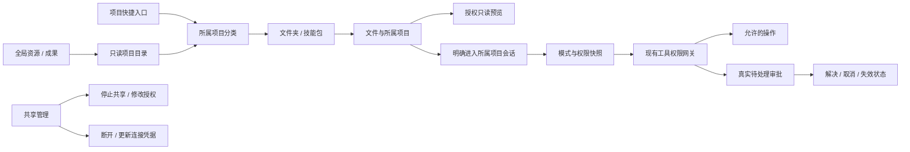

# 项目浏览、共享管理与审批修复

2026-10-05，版本 0.3.12。本轮实现与验收记录。

## 用户问题与交互方向

1. skills 按技能包文件夹展示，进入包后再浏览 SKILL.md、脚本与 references 等；首屏不递归平铺包内文件。
2. 资源中的“项目目录”指登记的项目根文件夹，不能用资源、成果等项目内部挂载替代。
3. 最左资源/成果是全局入口，先按项目组织，文件显示所属项目和所在位置；项目下的快捷入口只查看该项目。
4. 共享管理区分创建者的“停止共享/修改授权账号”与连接者的“断开/更新连接凭据”。Windows SMB 账号密码不是每个文件夹独立的密码，不能把更新连接凭据误做更改 Windows 账号密码。
5. 完全访问应按实际 Run 权限运行；过期、已解决或取消的审批不得继续显示为可操作。不能只吞掉 APPROVAL_NOT_PENDING 或通过取消显式拒绝、Plan 只读、原件保护来解决。

## 系统边界

全局目录读取基于已登记项目与各项目的权限快照，按需读取目录。浏览不初始化工作空间、不切换活动 Run、不写用户原件或项目索引。目录与文件访问仍经过真实路径、授权和链接检查，不能依赖前端过滤实现权限。

跨项目预览独立于会话编辑上下文；用户明确选择进入所属项目会话后再引用，不能静默把其他项目文件加入无授权会话。现有当前项目引用保持原行为。

共享操作走结构化宿主接口；停止共享只撤销共享入口，不删除目录；断开只针对选中的本机映射。关联账号和连接密码不出现在日志、列表、邀请文本或项目文件中。本轮禁止验收脚本改变真实共享、ACL、Windows 账号或用户现有盘符，实际双机行为单列未验证。

## 验收要求

- 两个项目各含资源/成果，同名文件仍能区分所属项目；全局浏览不改变活动项目、会话或正在执行的任务。
- 包含嵌套 references、脚本及空目录的 skills 首屏按包显示，进入后才显示当前层内容。
- 项目目录显示真实项目根；项目内入口与全局入口范围不同且清晰可见。
- 文件预览、引用、目录进入及已有右键动作不因新层级丢失；越界路径、链接和撤权仍拒绝。
- 共享停止、账号更新、单个映射断开与凭据更新有真实状态和失败反馈，取消表单不执行系统操作，不影响无关共享或目录。
- 完全访问允许的普通能力不错误进入 ask；显式 deny、Plan 写入拒绝、参考原件只读保留。
- 审批在重复点击、Run 取消/结束、过期或应用重启后保持一致；前端不展示可以重复操作的旧卡片。
- 主代理统一完成类型检查、适用回归、构建、隔离桌面验收与打包；测试状态与真实外部环境验证分别记录。

## 实现和验证

资源入口改为只读 ProjectCatalog，按项目和目录层级读取。全局入口不再递归平铺文件，项目下的快捷入口仍进入所属项目。自定义目录可以通过实际文件夹进入；跨项目预览不会初始化项目或切换当前会话。当前项目保留右键、阅读与引用；跨项目引用明确进入所属项目的新会话。

审批问题的两处根因分别是历史终态被 UI 当成 pending，以及删除会话替换数组造成 Broker 与 State 引用脱钩。完整修复见 [工具授权状态与完全访问](tool-approval-lifecycle-2026-10-05.md)。新任务在完全访问下不为普通 ask 能力等待；迟到的历史允许操作不再更改权限或重新执行工具。

共享管理新增停止本机共享、查看与修改所选显式授权、断开选中映射、更新连接凭据。停止不删除目录，替换 SMB 账号授权保留原有 NTFS 与无关授权，不声称消除了组或继承带来的访问。连接密码仅经敏感标准输入传递，不更改 Windows 账号密码。

已完成的验证：

- `npm run check`、生产构建通过。
- 全套 `npm test`：318/318 通过，无跳过；日志 `.test-data/release-0312-tests.log`。
- `project-catalog-ui-smoke.mjs`：真实 Electron IPC、隔离项目与配置的 10 项桌面场景通过；含两项目同名文件、嵌套与空技能包、跨项目只读预览保留会话和草稿、当前项目右键、明确跨项目引用。证据 `.test-data/project-catalog-ui-development-1791198688977/result.json`。
- 共享脚本 7/7 通过 Windows PowerShell AST 语法解析，仅解析、不执行共享操作；证据 `.test-data/share-management-ast-1791198610012.json`。
- 最后共享模块编码调整后，网络共享与审批专项 32/32 通过；日志 `.test-data/release-0312-final-targeted.log`。
- `share-management-ui-smoke.mjs` 9/9 通过，真实 Electron 渲染、所有共享 IPC 使用合成回执；检查更新、取消、密码清理、失败提示和深浅主题。清晰表单截图与结果位于 `.test-data/share-management-ui-development-1791199012450`。首轮测试断言未等待异步关闭的失败证据保留，修正测试等待后通过，未掩盖产品异常。详细契约见 [共享生命周期管理](sharing-lifecycle-2026-10-05.md)。
- 最终打包目录 `release/build-0.3.12/win-unpacked/slash.exe` 重跑资源 10 项及共享界面 9 项，全部通过、无页面异常；结果分别位于 `.test-data/project-catalog-ui-packaged-1791199261482/result.json` 和 `.test-data/share-management-ui-packaged-1791199258251/result.json`。最终资源路径面包屑已消除重复分类。
- 本轮已经生成的便携 EXE 直接启动、隔离加密模型配置恢复、IPC 和退出检查通过，证据 `.test-data/portable-0312-final/result.json`。用户随后明确日常仅通过启动 BAT 查看，不需要每次制作便携版；该约定已写入根 AGENTS.md，后续仅明确要求时打包。本次已有包保留在 build-0.3.12 中，不再作为默认使用入口。

限制：自动测试不能代替真实双机 SMB 验收。本轮不修改用户实际共享、账号、ACL、盘符或 `E:/code/slash test` 原件；共享系统操作使用注入 runner 验证，界面另用明确标注的模拟回执验收。跨项目 HTML 独立预览目前显示源码，交互预览仍沿用进入所属项目后的现有链路。主进程更新需要重启应用。
