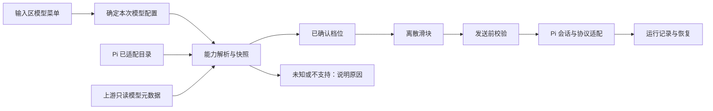

# 项目菜单与会话输入区改进

日期：2026-10-04。状态：已交付 0.3.2。关联 F01/F03/F17、PF03。本轮按用户最新要求补齐项目操作，简化输入区，并接入真实模型思考档位。

## 项目操作

右键项目分组提供：在此项目新建会话、打开资源、打开成果、重命名、置顶/取消置顶、打开本地文件夹、复制路径，以及删除项目。菜单和对话框应支持键盘、窗口边缘定位及明确操作反馈。

重命名改变应用显示名称，不移动本地目录。置顶是用户显式排序；展开或切换项目不应改变其余项目顺序。删除项目从应用登记列表移除，不递归删除本地文件或历史分区；确认框说明范围，运行中的任务阻止移除，重新打开同一路径可恢复原资料。当前项目或最后一个项目被移除时必须进入确定的有效状态，不自动复活被删项目。

目录型项目与云项目数据不同，本轮不引入永久清空磁盘操作。参考 [VS Code 多目录工作空间](https://code.visualstudio.com/docs/editing/workspaces/multi-root-workspaces) 的移除文件夹方式，以及 [Claude 项目管理](https://support.claude.com/en/articles/9519177-how-can-i-create-and-manage-projects) 的项目操作组织。

## 输入区

保持大尺寸多行输入面。删除常驻的“产品工作流”下拉，把预设改为按需打开的快捷动作。点击后提示词进入可编辑输入区；不得静默覆盖已输入内容。会议、原型转 PRD 和变更说明仍保留真实来源/版本的业务约束，选中上下文以可移除的简洁标记呈现。

模式、权限和模型用轻量文字按钮与锚定浮层呈现，弱化边框，保留完整权限选项和可理解的说明。模型选择仍按供应商分组、保留自动路由，菜单内提供思考档位控制。保留既有主题、字体、输入行高、引用资料及发送行为。窗口缩小或打开预览时不得溢出。

参考 [ChatGPT 模型与思考选择说明](https://help.openai.com/en/articles/20001354-gpt-56-and-gpt-6-pro-in-chatgpt) 的按需选择与思考滑块交互，不复制其订阅权益或模型档位。

## 思考能力的可信边界

- 优先复用项目已安装 Pi 的模型目录、思考档位映射和请求序列化能力。
- 只有精确的官方端点与适配模型，或上游明确返回且当前适配器能实际发送的能力字段，才显示对应滑块。
- [Claude 模型查询](https://platform.claude.com/docs/en/api/models/retrieve) 提供 effort 与 thinking 能力字段；[OpenAI 标准模型列表](https://developers.openai.com/api/reference/resources/models/methods/list) 不提供逐模型思考档位，不能由该列表推断。
- 第三方端点中的同名模型不自动继承官方能力。无法确认时明确展示原因、保留正常聊天，不提供虚假的档位。
- 滑块离散吸附到真实档位，支持键盘与减少动态效果偏好。相同底层值不展示成多个虚假档位。
- 能力快照绑定模型配置、端点、协议及精确模型 ID；配置变化后失效。切换模型/任务后不把旧模型不支持的档位带入新请求。
- 已验证供应商快照保存在本机，超过五分钟标为待更新，保留已知档位并提供“重新检测”。普通发送和恢复不反复联网查元数据；重新检测失败不等于模型不支持，明确的新声明则覆盖旧结果。
- 思考选项通过 IPC 校验后交给 Pi，并保存 Run 的实际选择。方案确认和恢复继承既有运行语义，不能改变工具权限。
- Plan 确认不传强度表示继承原选择，显式恢复默认单独表示；重新检测中若已有手动选择，暂缓发送以免丢失参数。
- 元数据查询是只读请求，不通过付费生成来探测；测试使用独立本地服务，不自动拿用户密钥访问云端。

源码备份：`.dev-backups/before-project-composer-20261004.zip`。使用 `redesign-existing-projects` 指导局部改造，代码由 GPT-6.1 Sol / High 子 Agent 完成，主 Agent 负责设计、审查与最终交付。

## 实现与验收

| 范围 | 主要实现 | 回归依据 |
| --- | --- | --- |
| 项目菜单与数据保留 | `src/Sidebar.tsx`、`src/App.tsx`、`main/service.ts` | `tests/project-management.test.ts` |
| 输入区轻量控件与提示词 | `src/ComposerControls.tsx`、`src/composer-intent.ts`、`src/composer-select.css` | `tests/composer-intent.test.ts` |
| 思考能力与真实请求 | `main/model-thinking.ts`、`main/model-runtime.ts`、`main/agent.ts`、`shared/types.ts` | `tests/model-thinking.test.ts`，含实际 Pi 到本机服务的协议验证 |
| Plan 继承与显式恢复默认 | `src/composer-thinking.ts`、`main/service.ts` | `tests/composer-thinking.test.ts`、模型思考测试 |

- TypeScript 检查通过。
- `npm run build` 通过，`.test-data/project-composer-build.log`。
- `npm test`：150/150 通过，`.test-data/project-composer-tests.log`。包含 Anthropic 官方 `/v1` 配置实际请求 URL 的构造验证，自定义代理路径不受影响。
- 新增桌面场景 16/16 通过，`.test-data/project-composer-development-1791099552441/result.json`；三套主题、两种窗口宽度及打开预览后的输入布局均有截图。
- 设置回归 34/34 通过，`.test-data/settings-review-development-1791099603324/result.json`。
- PM 主流程回归 10/10 通过，`.test-data/pm-focus-1791099773043/result.json`，包含实际 Pi 读取来源、生成待应用草稿及重启恢复。
- 打包程序回归 16/16 通过，`.test-data/project-composer-packaged-1791099934581/result.json`，无页面异常；测试前后 EXE 与 app.asar 哈希一致。该目录还保留项目完整右键菜单和删除确认框截图。
- 上述模型请求由真实 Pi 发往隔离的本机元数据/流式响应服务，验证能力映射、序列化、路由、来源与持久化，不代表云模型效果验收。文件夹选择使用隔离目录，打开文件夹只验证真实 IPC 到 shell 调用，不自动打开资源管理器。
- 最终便携 EXE 独立启动、隔离配置恢复、IPC 读取及关闭退出通过，`.test-data/project-composer-portable/result.json`。发布文件 `release/slash-0.3.2-portable.exe`，187327749 字节，SHA256 `04ca2c645d3687716b713c20bd710e7f935b7c2e5ef7ad90121dfeacc0d523bc`。
- electron-builder 下载解压后的目录改名遇到 Windows EPERM，发布包在独立的 `release/build-0.3.2` 目录复用已安装的同版本 Electron 44.0.0 分发文件成功生成，未修改依赖或运行时源码。最终构建命令为 `npx electron-builder --win portable --x64 --config.directories.output=release/build-0.3.2 --config.electronDist=node_modules/electron/dist`，退出码 0，日志 `.test-data/project-composer-pack-installed-runtime.log`；便携 EXE 复制到 release 根目录便于启动。旧版 0.3.1 便携 EXE 保留。
