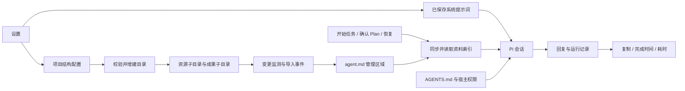

# 项目资源、回复与 Agent 指令改进

日期：2026-10-04。状态：0.3.3 已实现并完成本地验收。对应 F01/F02/F03/F05/F17 和个人 PM 范围。最新用户九项要求优先于历史布局。

## 会话

输入区提供三个独立入口：模型、模式、权限。模式仅为 Build、Plan；权限显示标准权限、自动接受、完全访问，继续沿用现有内部枚举与权限检查。自动接受只自动通过现有允许的编辑能力，不把明确禁止项改成允许。

助手回复底部提供复制完整 Markdown、生成完成时间与本次生成耗时。时间来自实际运行持久记录；流式、取消、失败与缺失历史元数据分别处理，不以渲染时间伪造生成耗时。

设置提供可编辑的系统提示词，带默认回复规范、保存、恢复默认与真实反馈。保存后下一次任务读取最新配置并注入 Pi；已开始的任务使用其既有快照。宿主权限、Plan 只读及工具网关限制继续独立执行。测试应捕获实际模型请求中的提示词，而非只检查表单回显。

## 项目目录

资源与成果仍按当前项目隔离。资源页使用项目目录、模板、流程图规范等页签，对应真实资源子目录。模板包含 PRD、蓝图、会议纪要、调研报告。成果按原型、PRD、流程图、调研报告、会议纪要和其他文件分类。

默认新项目目录：

```text
项目根目录/
├─ agent.md
├─ AGENTS.md
├─ 资源/
│  ├─ 项目资料/
│  ├─ 模板/
│  │  ├─ PRD/
│  │  ├─ 蓝图/
│  │  ├─ 会议纪要/
│  │  └─ 调研报告/
│  ├─ 流程图规范/
│  └─ 界面规范/
├─ 成果/
│  ├─ 原型/
│  ├─ PRD/
│  ├─ 流程图/
│  ├─ 调研报告/
│  ├─ 会议纪要/
│  └─ 其他/
└─ 过程文件/
```

设置中以树编辑项目文件夹结构，支持新增、重命名、移除配置节点及排序。配置保存与目录应用分别有明确状态。应用结构只增建和登记目录，不静默移动或删除用户已有文件；旧挂载及历史成果保持可访问，移除结构节点时显示磁盘保留范围。后续如需搬迁资料，必须用独立可核对的文件迁移流程。

树节点采用稳定 ID、单段目录名、资源/成果/过程用途和子节点。后端限制深度与总数，校验重名、越界、链接、项目身份及配置版本；切换项目后旧设置请求不得应用到另一个项目。

## agent.md

在项目根目录维护小写单数 `agent.md` 的资料索引。既有 `AGENTS.md` 保留为人工工作规则，两个文件用途不同。

- 资源导入及外部新增、变更、删除触发索引同步，合并密集事件；项目切换清理监听。
- 索引记录资料路径、类别及变更元数据，必要时限量摘录；不把所有原文塞入提示词，不使用付费模型生成摘要。
- 自动维护范围使用明确标记，保留手写内容；安全校验与原子写入避免覆盖和越权。
- 每次任务、Plan 确认与恢复前同步并实际读取索引，将来源和内容哈希记入运行证据。资料中的指令不能扩大权限。
- 索引体积受限，遗漏或截断必须明确说明，模型仍可按需搜索和读取实际文件。
- 保存项目结构与应用目录绑定项目身份及修订号；切换项目和应用目录互斥。监听错误要显示，权限撤销后不能继续使用旧监听快照。
- 索引异常不能阻止应用启动；保留错误供用户定位，任务开始前的索引读取失败则明确终止该任务。



## 验证范围

1. 设置保存及重启恢复；实际 Pi 请求包含修改后的提示词与本次 agent.md。
2. 默认结构、树编辑、路径与链接拒绝、旧文件保留、项目隔离。
3. 应用内导入和外部文件新增能够更新索引，删除能够移除旧索引条目。
4. 分离模式与权限的真实 IPC 参数、回复复制内容、时间元数据。
5. 资源页签、成果目录、文件预览、引用与导入功能回归。

已完成全量单元测试 160/160；开发版设置桌面回归 36/36、PM 工作流回归 10/10。真实 Pi 请求通过本地确定性兼容服务捕获，验证已保存提示词、人工项目规则与本次资料索引确实进入请求，Plan 不带写入工具；这些检查不代表云端模型回答质量评测。

新增桌面场景开发版 12/12 通过，覆盖分离菜单、模板文件预览、目标子目录导入、agent.md 同步、结构应用与旧文件保留、完整 Markdown 剪贴板、回复时间、流式取消和重启恢复。Windows 剪贴板仅规范 CRLF/LF 后比较完整文本。主进程启动恢复期间等待项目身份稳定后验证持久化，其他错误均使测试失败。

| 验证 | 证据 |
| --- | --- |
| 全量测试 160/160 | `.test-data/project-resources-tests.log` |
| 最终生产构建 | `.test-data/project-resources-build-final.log` |
| 设置桌面回归 36/36 | `.test-data/settings-review-development-1791104745526/result.json` |
| PM 工作流 10/10 | `.test-data/pm-focus-1791105013187/result.json` |
| 新增桌面场景 12/12 | `.test-data/workspace-ui-development-1791105399948/result.json` |
| 同一场景打包版 12/12 | `.test-data/workspace-ui-packaged-1791105497866/result.json` |
| 最终便携 EXE 直接启动、IPC、加密配置读取及正常退出 | `.test-data/project-resources-portable/result.json` |

打包版测试使用 `release/build-0.3.3-final/win-unpacked/slash.exe`。开发与打包版均无页面运行错误；打包目录的 EXE 与 app.asar 在测试前后哈希一致，证据为 `.test-data/project-resources-package-before.json` 与 `project-resources-package-after.json`。导入场景验证真实 IPC、文件系统和当前目录目标，未模拟操作系统原生拖拽传输。

视觉复核已检查独立模式/权限浮层、设置目录树、模板页签与预览、回复末尾时间与复制。叶子目录没有子文件夹时不显示误导性的“没有文件”面板，实际文件直接展示在列表中。

索引目前最多扫描 500 个文件、8 层目录，`agent.md` 文件大小上限 128 KiB；单文件哈希最多读取 8 MiB、每次总计 32 MiB。限量或读取问题会明确记录，索引不包含全部资料原文。资料实际内容仍通过受权限约束的读取工具按需获取。

主进程与 preload 均有变化。正在运行的旧开发进程需要完整停止并重新运行 `npm run dev`；仅刷新窗口不足以加载新增 IPC。便携版不携带测试资料、模型密钥或个人 CLI 状态。

## 交付

- 程序：`release/slash-0.3.3-portable.exe`，187,359,074 字节。
- SHA-256：`2776f98dca28661fd4051c497a40ef6c10e5d94fb7117cb001f3f822ec618df9`。
- 最终构建日志：`.test-data/project-resources-build-final.log`；打包日志：`.test-data/project-resources-pack-final.log`。
- 程序已直接运行，窗口与 IPC 正常、隔离测试模型配置可恢复，窗口和便携启动器均正常退出。
- 外部云端模型质量、钉钉/飞书发布和 SMB 双机行为不属于本轮新增验收，既有能力边界保持。

备份：`.dev-backups/before-project-structure-prompt-20261004.zip`。代码由 GPT-6.1 Sol / High 子 Agent 分工实现，主 Agent 审查、集成构建及交付。
