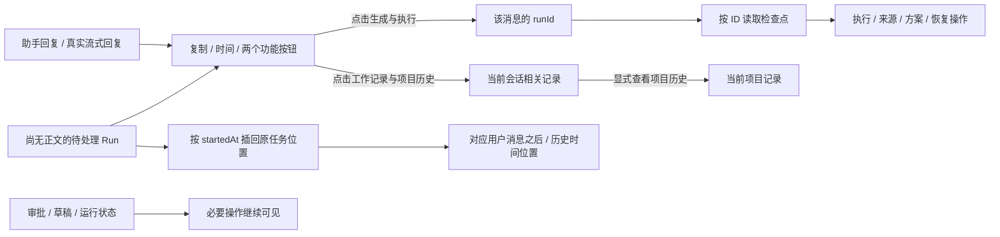

# 回复末尾的执行与工作记录

对应 F02/F14/F19。2026-10-05 用户要求：对话中的“生成与执行”和“工作记录与项目历史”改为每条 AI 回复末尾的功能按钮，点击后展开。

两按钮与复制、实际回复时间放在同一操作行，默认折叠；各回复、各面板独立切换，不因新状态或流式增量自动展开。第一次展开才挂载内容；折叠后保留已挂载内容，避免丢失未提交的方案补充或问题答复。

生成与执行只关联该助手消息的 `message.runId`，流式消息使用真实活动 Run ID；展开时按该 ID 查询恢复检查点。历史消息没有 ID 时显示无关联运行记录，不能展示最新任务。尚无助手正文的方案确认、失败或恢复任务提供明确标注的紧凑任务入口，点击展开原有方案及恢复操作。审批、外部写入确认、待应用草稿继续可见，输入区的停止任务按钮保留。

工作记录的数据范围仍是当前会话的关联需求、检查问题与处理记录，面板明确注明；“项目历史”按钮扩展到当前项目。它不是该条回复创建的记录，也不承诺消息级业务证据关联。成果视图既有工作记录入口保持原有折叠方式。

代码：`src/ReplyDetails.tsx`、`src/MessageFooter.tsx`、`src/WorkIssues.tsx`、`src/App.tsx`。不改后端数据，不迁移历史记录。界面验收脚本：`node scripts/reply-details-ui-smoke.mjs`，配置、资料和证据均位于独立 `.test-data/reply-details-ui-*`。开发应用正常重启加载前端变更；本轮不自动打包。

## 本轮验证

- `npm run check` 与 `npm run build` 通过；构建日志 `.test-data/reply-details-build.log`。保留原有前端包体积提示，不属于构建失败。
- 回复时间与 Plan / 权限相关回归 4/4 通过：`tests/message-receipt.test.ts`、`tests/agent-mode.test.ts`。
- `node scripts/reply-details-ui-smoke.mjs` 6/6 通过，无页面异常。覆盖默认收起、历史 Run 归属、独立开关、旧无关联消息、表单保留、无正文 Plan 入口，以及真实 Pi 本地流式取消后保持面板状态。截图与实际结果见 `.test-data/reply-details-ui-1791202799691/result.json`，已目视检查末尾按钮布局。
- 本轮未打包、未变更版本、未修改用户项目或配置。脚本仅使用隔离配置及本地确定性模型服务，不代表云端模型回答质量验证。

## 2026-10-06 历史任务入口位置修复

对应 F02/F19。无关联助手回复的旧失败/中断 Run 曾统一追加在整个对话末尾，使前一天的“应用退出”入口出现在当前正在生成的回复之后。任务归属按真实 runId 正确，但位置造成最新任务失败的误判。

保留消息原始顺序和原有待处理任务过滤规则，仅把无关联 Run 的紧凑入口按 `startedAt` 插回历史位置：有同一开始时间的用户消息时放在该消息之后；旧记录缺少准确输入时放在第一条时间更晚的历史消息之前。恢复或重启修改的 `updatedAt` 不改变原任务位置。同位置的任务按开始时间排列，无法判断时间的记录仍保留可见。最新失败仍在最新输入后，旧 Run、恢复按钮、方案确认和助手回复末尾操作均保留。

代码：`src/run-history-anchors.ts` 与 `src/App.tsx`。紧凑任务入口显示任务开始日期和时间，流式助手仍在当前输出末尾；不迁移和改写任何持久化会话记录。`npm run check` 通过；`tests/run-history-anchors.test.ts` 4/4 通过，覆盖昨日中断与今日活动任务、最新失败、已关联回复去重、历史缺少输入、方案确认、空历史与无效时间；加现有回复时间状态测试共 6/6 通过。App 已在真实任务终结后接入，桌面验收由主线程完成。

主线程统一构建后，`node scripts/run-history-ui-smoke.mjs` 纯渲染夹具 4/4 通过，无页面异常。覆盖旧任务日期及其在今日输入/live之前的位置、恢复入口、最新无正文失败仍在尾部、关联助手操作保持和无正文待确认方案入口。证据：`.test-data/run-history-ui-1791281331407/result.json`、`historical-order.png`、`historical-before-live.png`、`latest-failure.png`，已目视核对日期和消息布局。夹具使用独立浏览器和合成 `pm` bridge，不访问用户配置，不发模型、恢复或确认命令；只证明渲染呈现，不能代替桌面 IPC 和真实模型集成验收。本子任务未构建或打包。

主线程真实窗口刷新只读验收：旧 `8913ea11` 入口位于 2026/10/5 20:04 的原用户输入后、今日 17:56 输入前；当前 `515c14fe` 助手失败 footer 仍显示 18:06:50 和 10 分 0 秒，展开显示当前任务真实 `TIME_BUDGET_EXCEEDED` 及继续入口。此次未发起恢复，恢复执行不能由按钮可见推定成功。完整真实任务诊断和验证记录见 [运行流式错误与中断](runtime-stream-error-2026-10-06.md)。
