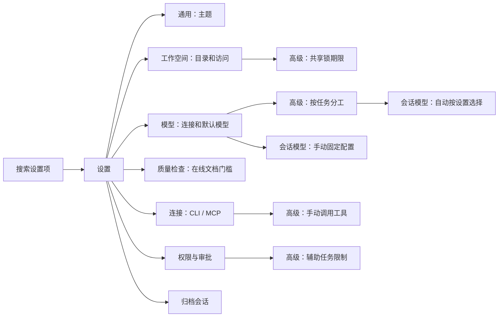

# 设置整理与有效性检查

日期：2026-10-04。状态：已实现并验收，交付版本 0.3.1。范围：F01/F03/F17/F19、PF03。本轮以“设置必须能改变实际行为、按用途归类”为准，不用说明文字和运行记录填充设置页面。

## 本轮取舍

| 原问题 | 处理 | 行为约束 |
| --- | --- | --- |
| 设置中的任务与回执是记录页 | 删除分类、页面和专属接线 | 会话中的运行状态、继续任务、审批、交付结果和底层历史保留 |
| 通用的界面区不能设置，工作空间区只是重复跳转 | 删除，通用保留真实主题选择 | 不为了填满页面新增参数 |
| 质量页包含模型、编排和共享参数 | 模型分工归模型；有效辅助任务限制与只读工具归权限；共享锁期限归工作空间 | 高级区默认折叠，打开页面不修改既有配置 |
| 目录列表与权限分处两页，启用与禁止重复 | 工作空间集中管理目录访问，保留一个三态选择；补直接添加参考目录入口 | 默认新参考目录只读；系统选择取消不修改状态；权限页可定位目录配置 |
| 质量两个开关作用重叠，重新检查描述不实 | 合为在线文档发布前强制质量检查 | 读取两旧字段的有效 AND，只有用户操作时同时保存；不改变后台检查和保护逻辑 |
| 会话强制指定默认模型，使自动分工无法触发 | 模型选择增加可保持的自动选项；手选模型仍固定 | 自动时按设置路由，固定默认模式使用实际默认配置；显式模型不可用不能串到同名端点 |
| 原型工作流未映射代码分工，预检查与发送分类不同 | 预检查和发送使用统一任务分类；原型归代码，评审命令归评审 | 显式模型选择优先，Plan 确认沿用既有运行上下文 |
| 分工只存模型名，跨供应商可能重名 | 新选择存模型配置 ID，名称显示供应商 | 兼容旧值，不擅自替换旧配置；删除目标需要明确展示 |
| 成本优先和回退顺序没有相应配置依据 | 不再提供新选择，保留旧值兼容说明 | 不宣称已经完成成本优化或可配置回退顺序 |
| 辅助任务最多拆分层级只保存、不消费 | 移除编辑控件 | 不扩展运行权限，也不删除历史字段 |
| 搜索只能按 Enter 匹配分类标题 | 搜索实际设置项并显示结果，可定位及展开对应高级项 | 无结果明确提示，不悄悄跳转通用 |
| 连接配置下面直接显示手动 MCP 工具及 JSON | 放入默认折叠的高级操作 | 连接列表、发现、测试、启停和编辑保留 |

质量开关目前作用于官方 CLI 的在线文档交付（飞书、钉钉），不是本地导出或任意 MCP 调用的全局开关。即使关闭强制质量门槛，空文件、版本冲突、未解决问题及结果未知等原有独立条件仍按实现处理。

## 整理后的分类

1. 通用：主题。
2. 工作空间：当前目录、添加参考目录、目录访问；高级共享锁期限。
3. 模型：供应商与模型列表、默认模型、图片辅助模型；高级自动分工。
4. 质量检查：在线文档发布的质量门槛。
5. 连接：MCP/CLI 列表和能力检测；高级手动工具调用。
6. 权限与审批：能力权限、待审批；高级辅助任务数量与只读工具。
7. 归档会话：恢复、打开和删除。

独立源图：`diagrams/settings-review.mmd`。

## 缺失项判断

当前模型、连接、能力权限、目录访问、归档管理这些必要配置已经有基础实现。本轮补齐的是能实际使用的自动模型分工与设置搜索，并把添加已有参考目录放回目录管理处。

仍可考虑但本轮不新增：发送快捷键偏好、阅读字号。它们比更多底层编排参数更贴近日常 PM 使用，但需实际偏好决定，不应为了让通用页显得丰富就添加。

## 验收要求

- 七分类和搜索可用，任务页及静态说明区不再出现。
- 主题、目录权限、模型配置和归档操作保持可用；窄窗口无控件溢出。
- 仅查看高级项不改变旧偏好；质量旧值组合显示正确，用户修改后两个字段一致。
- 自动分工、固定默认及显式手选均经过真实 Pi 本地模型流程验证；同名模型按配置 ID 区分。
- 配置重启可恢复；无用户日常资料写入，无实际云端发布或 SMB 系统修改。
- 源码备份：`.dev-backups/before-settings-review-20261004-142912.zip`。代码实现采用 GPT-6.1 Sol / High 子代理，主代理负责设计、构建和交付。

## 实现位置与验证记录

| 范围 | 实现 | 验证 |
| --- | --- | --- |
| F01 设置分类与有效控件 | `src/SettingsModal.tsx`、`src/settings-focus.css` | 七分类、旧值只读兼容、两个窗口尺寸与三主题 |
| F03 目录管理 | `SettingsModal.tsx` 的工作空间区 | 目录访问实际保存、添加参考目录入口 |
| F17 模型配置与自动分工 | `src/composer-intent.ts`、`src/App.tsx`、`main/service.ts`、`main/main.ts`、`shared/types.ts` | 同名跨供应商、固定默认、显式优先、工作流任务分类、Plan 分类继承 |
| F19 / PF03 可追溯与运行保护 | 单一质量开关；保留后台运行与交付对象 | 旧质量值不迁移、用户切换双字段一致、旧运行记录仍存在 |
| 设置查找 | `src/settings-navigation.ts` | 真正条目匹配、展开高级组、无结果提示 |

- `npm run check`：通过。
- `npm run build`：通过，日志 `.test-data/settings-review-build-final.log`。仍有既有渲染包大于 500 kB 的构建提醒，不影响本次构建结果。
- `npm test`：136/136 通过，日志 `.test-data/settings-review-tests-final.log`。
- 开发版设置回归：29 项通过，`.test-data/settings-review-development-1791095917950/result.json`。包含四次实际 Pi 运行，模型响应由本机测试服务提供。
- 产品工作流回归：10/10 通过，`.test-data/pm-focus-1791095951910/result.json`。
- 最终打包应用回归：34 项通过，`.test-data/settings-review-packaged-1791096330656/result.json`；两个窗口尺寸、七分类、三主题、搜索定位、目录权限、模型/连接编辑、归档删除和重启恢复均通过。六次实际 Pi 运行覆盖文档、原型、评审、固定默认、显式手选及重启后的模型选择。
- 主题卡片标题和说明的文字对比度均达到 4.5；主代理复看深色主题、模型分工及工作空间截图。测试不代表全应用已经做完无障碍审计。
- 最终打包目录的 EXE 与 app.asar 在验收前后 SHA-256 一致，证据 `.test-data/settings-review-packaged-hashes-before.json` / `settings-review-packaged-hashes-after.json`。

测试使用独立测试目录、加密的测试密钥及本机模型服务，没有读取或改写日常用户数据。目录选择器自动化替换为返回测试路径，验证的是选择完成后的应用流程；真实 Windows 选择器交互、实际云端 CLI/MCP 发布和 SMB 双机连接不在本次验收范围内。

## 交付

- 可直接运行：`release/slash-0.3.1-portable.exe`，187,225,785 字节。
- SHA-256：`21bf934403f1bd0e40fe8c57efd1e8d5bad24a0fb6bc8f53e1d6c191e975b736`；同目录提供 `.sha256` 与 `build-info.json`。
- 打包命令成功：`npx electron-builder --win portable --x64`，日志 `.test-data/settings-review-pack.log`。
- 便携 EXE 直接启动、加密测试配置恢复、窗口展示、IPC 和退出均通过：`.test-data/settings-review-portable/result.json`。
- 开发入口仍为项目根目录的 `双击启动开发环境.bat` 或 `npm run dev`。已运行的旧窗口需关闭，再启动本次版本。
