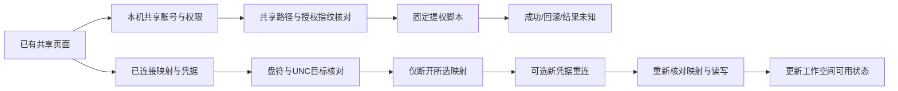

# 共享生命周期管理：2026-10-05

状态：代码完成，离线mock命令与PowerShell仅解析验证通过；桌面mock验收另见真实回执。没有在开发者机器创建/撤销共享、改账号/ACL或断开现有盘符。SMB双机、提权及Windows凭据管理器行为仍未实机验证。

共享页面继续保留创建与连接向导，在已有列表内管理生命周期，不增加导航中心。`src/ShareManagement.tsx`由`SharingPanel`嵌入，`App.tsx`不需要接线修改。

| 对象 | 操作 | 明确边界 |
| --- | --- | --- |
| 本机分享的文件夹 | 查看当前显式账号及Read/Change/Full；替换一条账号授权/添加账号；读写切换 | Windows提权，核对共享名、路径和SMB权限指纹。只撤选中的旧SMB显式Allow；保留旧账号NTFS规则、其它账号、组和继承权限。UI说明残留访问需Windows另核对，不能由“换账号”推断彻底失权。新账号补ReadAndExecute/Modify并核对显式NTFS规则；出错恢复本次前状态，回滚未核对标未知。 |
| 本机分享的文件夹 | 停止对外共享 | 核对name/path并拒绝管理共享，仅Remove-SmbShare所选对象；不删目录/文件、不修改目录ACL。现有连接可能中断，表单先说明并可取消。 |
| 已连接的共享 | 断开映射 | drive+expectedRemotePath复核，Remove-SmbMapping只选中对象并UpdateProfile；不通配、不自动断开同主机其它盘符。撤销/结果未知时停用匹配工作空间mount避免旧写权限继续生效。 |
| 已连接的共享 | 更新连接账号/密码并重连 | 显式说明先断开，失败可能已断开。新密码仅隐藏PowerShell stdin；UTF8收发，参数、邀请、业务manifest和操作日志均不存密码。不会调用Set-LocalUser/net user或更改系统账号密码。重连后再核对映射/读权限，写探测失败登记只读。 |
| 已连接的共享 | 可选清保存凭据、保存新凭据 | 用户明确选择。cmdkey /delete仅该host，不清所有凭据；按主机保存可能影响该主机其它共享下次认证，UI同步提示。清除失败明示partial，不能假称全部完成。 |

API schema在`shared/network-share-management.ts`，IPC分支在`shared/types.ts`与`main/main.ts`，固定用途系统命令在`main/network-share.ts`。权限设置属于用户手工配置；Agent没有任意共享管理Shell入口。管理员超时/UAC未返回/无有效回执均需刷新核对，不自动盲重试。并非修改Windows账号密码的功能。

UI密码永不回填，取消关闭、开始提交、异常/成功结束均清输入状态；凭据表单和结果只保留必要账号/目标信息。新授权选择与读写菜单复用ComposerSelect，无Windows原生select。暖白/深色使用实际theme-surface等主题变量。

验证：

- `npx tsx --test tests/network-share.test.ts tests/network-share-management.test.ts tests/sharing-setup.test.ts`：25/25通过。
- `npx tsx scripts/share-management-ast-check.mts`：7份真实生成脚本通过Windows PowerShell AST解析（`Parser.ParseInput`），没有执行脚本。最终回执`.test-data/share-management-ast-1791198608026.json`。首次工具未给stdin指定UTF8的失败回执保留，修正测试传输后确认脚本语法有效；网络模块也明确UTF8以正确传递非ASCII密码。
- `node scripts/share-management-ui-smoke.mjs`：真实Electron界面、隔离.test-data/profile，但ALL share* IPC被mock替换，未列明共享操作直接拒绝。会留下实际桌面截图/版本/userData/pageErrors/退出状态。支持`--packaged --executable <path>`，不把mock当作双机集成。

官方依据：[Remove-SmbMapping](https://learn.microsoft.com/en-us/powershell/module/smbshare/remove-smbmapping?view=windowsserver2025-ps)规定UpdateProfile移除持久恢复记录；[New-SmbMapping](https://learn.microsoft.com/en-us/powershell/module/smbshare/new-smbmapping?view=windowsserver2025-ps)提供Credential/SaveCredentials；[Remove-SmbShare](https://learn.microsoft.com/en-us/powershell/module/smbshare/remove-smbshare?view=windowsserver2025-ps)只移除指定共享；[cmdkey](https://learn.microsoft.com/en-us/windows-server/administration/windows-commands/cmdkey)按指定目标删除保存凭据。不同Windows版本/策略及双机有效访问仍需实测。

实际开发版桌面mock最终9/9通过（0.3.12，pageErrors=[]，exit0，userData隔离匹配）：[结果回执](../.test-data/share-management-ui-development-1791199012450/result.json)。暖白/graphite当前授权及更新凭据完整表单截图已实际目视检查，取景改为展开表单而非滚动父容器；不是生产布局修正。首次1791198859005因测试等待按钮存在就立即数DOM而时序失败，修为等待密码input真正detached，失败回执保留。第二次1791198901447已9/9通过，最终1791199012450仅脚本改截图定位后再次9/9通过。打包版结果须独立运行标记，不能从本开发版mock推断。
