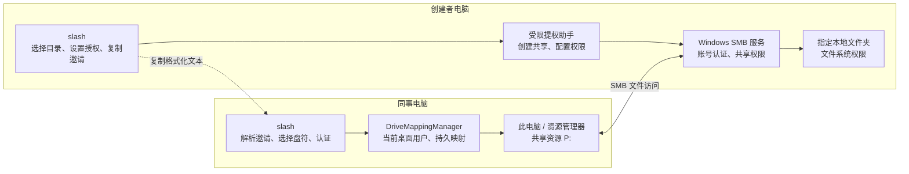

# slash 网络盘共享设计

版本：v0.1 · 2026-09-26 · 已实现共享创建、权限升级和连接端读写核验；双机系统验收仍需实际 Windows 设备。

## 1. 产品效果与技术决策

同事在 slash 粘贴邀请，选择例如 P:，认证并连接后，在 Windows“此电脑”看到网络驱动器，可在资源管理器或其他应用中打开共享文件。盘符指向创建者共享目录，不复制整个目录到接收者电脑。

采用 Windows SMB + 用户级网络驱动器映射。使用系统共享与映射能力，不开发虚拟文件系统驱动。共享由指定 Windows 账号读写，权限同时在 SMB 共享 ACL 与文件系统 ACL 落实；不使用 Everyone 或来宾访问。

## 2. 共享架构图



文件数据通过 Windows SMB 传输，slash 负责创建、连接、诊断和资源索引。创建者退出 slash 后，系统共享通常仍可使用，前提是电脑在线且 SMB 服务可用。接收者退出应用默认不移除盘符。

## 3. 创建端流程

2026-09-21 易用性修订：日常入口使用“共享我的文件夹”向导。先选择文件夹，再展示检测结果与访问身份，最后创建并复制邀请。主机由系统获取；共享名称自动生成，显示名使用文件夹名称；授权账号优先从当前 Windows 身份和可用本机账号选择，高级输入只用于特殊域环境。每个账号选项应说明同事连接时需使用何种身份，不能把创建者的当前身份等同于同事已获得访问权限。已有共享与断开网络盘单独列出，不把它们混入创建表单。

1. 选择目录，检测现有共享、路径、Windows 版本、服务及网络策略。
2. 设置共享名称、授权账号和权限。优先使用已有域账号或创建者电脑可验证的账号；不把 Everyone 或来宾访问作为默认方案。
3. 在必要时通过 Windows 提权界面授权受限助手创建共享，检查共享权限与文件系统权限；保留既有合法权限，不粗暴重置目录 ACL。
4. 检测局域网访问条件，必要配置明确限定为相关网络范围；企业策略阻止时显示具体原因，不静默修改企业策略。
5. 生成邀请，展示共享名称、主机、权限和原始路径。管理入口可停止共享或调整账号权限。

邀请仅提供寻址信息，不能自动给同事授予系统账号权限。工作组环境下首次连接可能需要共享方认可的账号及密码；产品引导认证，不假定双方已处于同一域。

已有同路径共享可以升级为读写：为指定账号授予 SMB Change 和 NTFS Modify，并复核最终权限；旧的宽泛共享访问项需在可回滚的范围内移除，其他具名账号权限保留。升级失败时恢复原共享及目录 ACL，不把只读旧共享误报为读写成功。邀请文本本身不包含权限凭据。

## 4. 接收端流程

日常入口使用“连接同事的文件夹”。粘贴后先解析目标并推荐空闲盘符；尝试当前 Windows 身份，返回认证问题后才展开账号密码。邀请无效、电脑离线、盘符冲突和认证失败使用不同提示，不把所有异常都解释成需要重试密码。邀请不得包含密码。

1. 粘贴邀请并解析，校验版本、provider、主机和共享名称；仅支持标准 SMB 共享目标，拒绝命令、脚本、设备路径和路径穿越。
2. 展示共享方与目标，推荐空闲盘符 P:，已占用时列出其他可选盘符，不覆盖现有驱动器。
3. 尝试当前身份认证；需要时弹出凭据输入，提供“记住凭据”选项。密码不进入邀请、日志、命令行参数或业务 manifest。
4. 在当前桌面登录用户上下文创建持久映射，确认映射目标一致并测试读写，随后提供“在资源管理器打开”。
5. slash 资源中心记录 ShareMount，业务引用以稳定资源 ID 和 UNC 路径为主，盘符仅作本机呈现，避免不同设备盘符不同导致引用失效。

创建端提权与接收端映射应分离：管理员或服务会话中创建的映射可能不对普通资源管理器可见。应用不能只依据映射命令成功就宣称用户已看到盘符。

## 5. 邀请与接口

固定格式：`slash-share:v1:<base64url 编码的 JSON>`。

解码示例：

```json
{
  "version": 1,
  "provider": "windows-smb",
  "resourceId": "pm-resources-001",
  "host": "PM-DESKTOP",
  "shareName": "PMResources",
  "displayName": "产品共享资料",
  "suggestedDrive": "P:"
}
```

不携带密码；resourceId 用于产品关联，不是安全身份凭据。主机名优先，IP 变化或主机重命名会影响连接，需提供更新目标和重新验证入口。固定的是文本结构，不承诺网络地址永不改变。

DriveMappingManager 提供 listMappings、validateTarget、connect、inspect、reconnect、disconnect；SharingAdmin 提供 inspectFolder、createShare、inspectPermissions、updatePermissions、stopShare。分别承担普通用户映射与需要提权的共享管理，接口不接收任意 Shell 命令。

映射状态包括 connecting、auth_required、connected、disconnected、target_unreachable、conflict、permission_denied。盘符存在不代表目标在线。

## 6. 异常与生命周期

| 场景 | 处理 |
| --- | --- |
| 已有相同目标映射 | 展示并允许复用，不重复创建 |
| 盘符被占用 | 推荐空闲盘符，保留原映射 |
| 同一服务器已有另一账号连接 | 提示凭据会话冲突，列出关联连接；不自动断开同事其他网络盘 |
| 共享方关机、休眠、断网 | 显示离线；不将盘符存在当作连接成功；恢复网络后重新检测 |
| 登录后自动恢复 | 持久映射尝试恢复，仍受网络、凭据和系统策略影响，不保证每次立即可用 |
| 取消本机连接 | 仅移除所选映射；删除保存凭据需单独选择 |
| 停止对外共享 | 移除共享入口或权限；提示现有连接影响，必要时明确处理活动会话；不删除本地目录 |
| 资源管理器直接写入 | 由服务端 SMB Change 权限与 NTFS Modify 权限约束；Slash 的工具网关不能替代 Windows 权限 |

映射不提供自动同步、多人编辑冲突合并或离线副本。多人同时编辑同一文件时仍可能冲突；应用内写入按版本基线处理，资源管理器与第三方应用的写入由用户自行协调。

## 7. 验收标准

- 两台 Windows 电脑完成创建、粘贴邀请、认证和映射；普通权限资源管理器中可见盘符，并可创建、修改和读取测试文件。
- 退出双方 slash 后，在系统共享仍可用的条件下继续访问；重启接收端后验证持久映射恢复。
- 验证共享方断网、休眠、恢复网络、账号失效和权限撤销的实际行为。
- 验证盘符冲突、同主机不同账号冲突以及现有映射复用，不影响无关网络盘。
- 分别从 slash 和资源管理器验证指定账号的读写权限；未授权账号仍应被拒绝。
- 断开映射和停止共享均不删除源文件；不共享活动 SQLite、凭据或执行接口。

## 8. 官方参考

- [New-SmbShare：创建 SMB 共享](https://learn.microsoft.com/en-us/powershell/module/smbshare/new-smbshare)
- [New-SmbMapping：映射本地盘符与远端路径、持久化](https://learn.microsoft.com/en-us/powershell/module/smbshare/new-smbmapping)
- [提升权限与普通用户之间的映射驱动器可见性](https://learn.microsoft.com/en-us/troubleshoot/windows-client/networking/mapped-drives-not-available-from-elevated-command)

## 2026-10-05 生命周期补充

共享页已增加本机共享的显式账号/读写授权更新与停止入口，以及连接端断开、更新连接凭据后重连、可选清保存凭据。连接密码不会被误当成系统账号密码修改；替换共享账号保留旧NTFS与其它/组授权，不能由一条SMB显式授权撤销推定全部访问撤销。实现与mock/仅解析验收、真实双机未验证边界见[共享生命周期管理](sharing-lifecycle-2026-10-05.md)及[Mermaid源](diagrams/sharing-lifecycle.mmd)。

## 2026-10-05 账号识别修复

已有共享ACL按SID区分用户、组与未知，不能把第一条Allow组当成当前用户。无当前个人授权时默认添加已核对的当前Windows账号，保留现有授权；有个人授权时按SID命中。创建与管理表单支持当前账号自定义菜单及手输，身份不可用不猜测账号。实现、真实只读与离线验收见[共享账号识别修复](share-account-identity-2026-10-05.md)。
