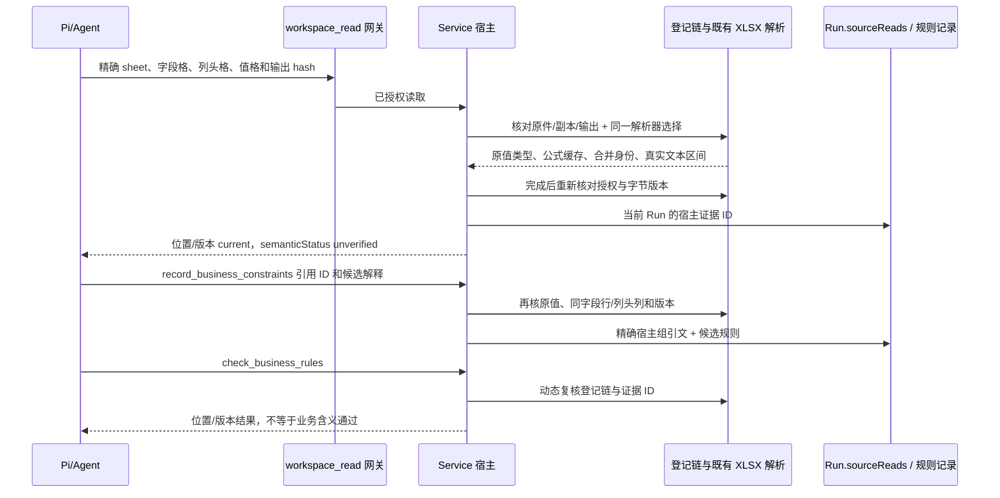

# 宿主表格字段证据

2026-10-08 参数描述与专门错误恢复修正见 [表格字段工具参数与错误恢复](spreadsheet-tool-guidance-2026-10-08.md)。真实任务失败保留，宿主不自动修改错误请求。

2026-10-08 新增只读定位入口见 [已登记表格的有界导航](spreadsheet-navigation-2026-10-08.md)。目录与行片段不产生字段证据，后续仍走本工具严格核验。

状态：已实现（2026-10-07）。只读工具、现有 Run.sourceReads 宿主证据、候选规则引用与动态复核已接入正式源码。不接独立内容审查预算，不增加数据库、界面或模型调用。验证范围见下文；真实云模型能否准确利用该工具仍待后续测试，不能把本机回环与格式演示称为模型业务判断通过。

## 范围与接线

一个 `read_spreadsheet_field_evidence` 只读工具，经既有 workspace_read 网关、Files 授权、Processing 回执、ExcelJS 与现有 SAX 安全检查器执行。它要求已登记、已应用的内置 XLSX extract_text 输出，逐次核对原件、副本、输出以及当前项目。普通 TXT 内含 A1 坐标只证明该文本内容；脚本输出、旧缺链、未应用、跨项目、循环或多跳链均不冒充原 Excel 证据。

`shared/spreadsheet-field-evidence.ts` 定义严格输入/返回，`main/office-extraction.ts` 在同次现有解析与原样序列化中选择单元格，`main/spreadsheet-field-evidence.ts` 生成稳定版本身份及精确文本绑定，`main/service.ts` 验证、保存既有 Run.sourceReads、记录/复核候选规则，`main/agent.ts` 接一个原生 Pi 工具。既有 ProductRecords/Store 容器只增加可选字段。



## 最小 API

```ts
read_spreadsheet_field_evidence({
  mountId, path, expectedContentHash, // 真实已应用提取 TXT 的确切版本
  sheet, fieldCell,
  values: [{ valueCell, headerCells }],
});
// 最多 8 个独立值格，每格 1–3 个显式列头。地址必须在 Excel 范围。
// 返回 {state,evidence,reasons}，完整 JSON 上限12000字符；单格上限2000。

record_business_constraints({
  requirementId,
  constraints: [{ /* 既有候选规则字段和 sourceEvidence */
    spreadsheetEvidenceRefs: [{ sourceRefId, evidenceId }],
  }],
});
```

证据 ID 只可引用**当前 Run**实际读取的回执，跟进会话/恢复形成新 Run 时必须重新读取。没有扩展到同会话历史或任意继承链。输入不接受模型填写的 fieldEvidence；宿主根据 ID、requirement 来源、确切版本重算后写入。

读回执保留 requested/master 地址、合并范围、隐藏标志、字段格、显式列头、值格，以及原样文本区间。只有成功验证同字段行与列头覆盖关系时返回 current。字段/列头必须是非空静态文本；跨行/跨列合并值格拒绝，空白未提取值不猜“否”，不存在的 sheet/坐标拒绝。字段轴标识包括原始文件、sheet、字段合并身份、列头及列；替换已有结构证据时还必须保持同一轴。

数值、布尔、文本、日期/错误的 scalar 独立保留类型。数字格式不把17转换成文本00017；字符串前后空白保留在原值。现有业务规则 rawValue 字符串模式会 trim，因此空白原值不能无损记录时明确拒绝 `SPREADSHEET_RAW_VALUE_WHITESPACE_UNSUPPORTED`，没有静默修改 Excel 值。纯文本旧接口及旧记录继续兼容。

公式单独记录 formula 和 `cachedResult:{state:'missing'}|{state:'present',scalar}`，始终 formulaExecuted=false；0、false、空串不能按真假值丢失。ExcelJS 对 `<c t="str"><f>…</f><v/></c>` 丢空串缓存，所以在**既有受限 SAX 检查**中只为指定值格记录明确空缓存，按工作簿 sheet 与 worksheet relationship 绑定，不新造第二个 XLSX 解析器。原提取文本 serializer 不改变，旧文本“无缓存”标注可能保留这个已知解析器局限；结构化 empty-string 缓存来自同份真实 XML，不能把旧正文串当类型证据。公式/错误/解析不支持值只能记录 unknown，不能提升为已确认业务规则。

## 记录与复核

引用组合证据时，宿主替换对应 sourceEvidence 为真实字段+列头+值组的 exact quote/行段；全部仍通过 quoteLocated。合法短 `是/否` 引文只在属于这份宿主核验组时免除旧每格8字符启发式。无结构证据的纯文本模式仍要求足够上下文。sourceReads.includedCharacters 对真实区间求并集，重复字段/列头不重复计数，部分读取始终 truncated=true。

check 动态核对字节链和重算证据；原件、副本或输出改变则不能保持 current。撤权后不返回字段正文，切项目/读取过程撤权或替换文件拒绝并不保存回执。列表不展出完整 fieldEvidence。结构证据本身可持久化，重启后复核；旧记录不会自动获得 Excel 证据身份。

每次读取、一次 record 和一次 check 共享保守的256 MB读预算，现有 Office 单文件/解压/XML/单元格和2 MB输出限额继续有效；记录末尾再复核也计入该预算。预算不足不返回部分证据冒充 current。Task 的 business_provenance 检查在其约束批次共用同一 resolver。该保守策略可能拒绝较大工作簿，后续优化需另行评审，不能以扩大预算隐藏限制。

## 验证边界

合成回归使用真实 Service、Store、Files、Processing、ExcelJS；原生 Pi 的本机 HTTP 回环实际覆盖工具 schema→网关→宿主→回执→持久化，0真实云请求，不能代表云模型质量。冻结真实 XLSX 演示仅证明用户资料格式适配与坐标/字节链：新隔离 profile/project readonly mount→copy_for_processing→内置 extract_text→apply仅隔离输出→D2/D3字段+ A/H/F/O/P真实列头和值。其 sourceReads 使用明确标注的 host-only synthetic active Run，无官方 send、无模型、无应用启动。

**current 只验证这一组字节、位置与原值，不确认“新增展示”与“后续变更”如何解释，也不裁定对象、生命周期、上线阶段或制度效力。semanticStatus 固定 unverified、humanConfirmed 固定 false。**

通俗地说，这个小工具把“哪张表、哪个字段、哪一列、原格写的是什么”绑成一组可复核证据，防止模型把邻近列的“是/否”抄错后还能混过版本检查。它不会代替业务人员判断这些列在什么阶段生效。
