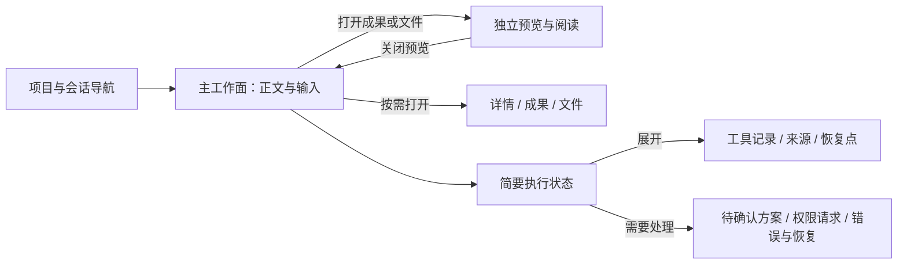

# Slash 前端视觉层级重设计

日期：2026-10-04。状态：已实施，已完成本轮 UI 与便携版验证。版本：0.2.1。

## 问题与目标

用户反馈：界面看着尚可，但到处都有重点凸显样式，实际使用难以找到重点。此次调整针对工作界面的信息层级和可操作性，不改变业务范围、权限语义或已有资料。

现有界面中，品牌、新会话、当前项目、当前会话、快捷动作、工作流和输入区选项同时使用底色、边框或粗体；辅助详情默认占用主画布。多轮样式覆盖也使局部修改容易产生不一致。

## 参考与取舍

- [Codex 官方介绍](https://openai.com/index/introducing-the-codex-app/)将会话按项目组织，允许在会话中查看工作与变更。借鉴稳定的任务导航与工作上下文，不复制开发者专用的多代理管理界面。
- [Claude Artifacts 官方说明](https://support.claude.com/en/articles/17153992-what-are-artifacts-and-how-do-i-use-them)将较完整的成果放入会话旁独立窗口。借鉴按需打开、独立阅读与迭代的组织方式。
- 下面的字号、间距、颜色和默认折叠决定是针对 Slash 的设计判断，不声称来自这些产品的内部规范。

## 视觉与交互约定

| 区域 | 层级与处理 | 不可损失的行为 |
| --- | --- | --- |
| 会话正文 | 主工作面；中文无衬线、可读行宽、左右留白；助手回复不套大卡片 | Markdown、流式跟随、手动上滚暂停跟随、引用与消息操作 |
| 输入区 | 充分的多行输入空间；容器边界清楚，底部工具轻量 | 引用选择器、自定义选框、模型/权限/模式切换、发送与取消 |
| 空会话 | 简短提示与轻量起始动作，避免大面积卡片墙 | 原型、PRD、资料和会议工作流可发现 |
| 左侧导航 | 图标上、文字下；项目与会话有稳定缩进；仅当前会话柔和选中 | 项目隔离、右键、搜索、新会话、设置、资源与成果 |
| 右侧信息 | 默认收起、按需打开；元信息使用次级字号与间距 | 详情/成果/文件、关闭与重新打开、文件预览 |
| 执行状态 | 摘要先行，详细记录展开查看 | 真正的等待确认、错误、草稿应用与恢复入口必须可见 |
| 资源/成果/设置 | 靠布局、行间距和分隔组织内容，减少盒中盒 | 现有按钮、选择、连接、共享与配置功能 |

视觉复核补充：设置采用分类和表单双栏，不再常驻一列重复的提示。成果预览保留直接引用与原型点选等常用动作，其他操作按需展开。会话与文档统一支持 Markdown 表格，表格自行滚动，不挤宽整个会话；任务列表保持只读。

颜色只表达主操作、当前选择和真实状态；不靠降低文字可读性来降低视觉权重。三种主题遵循同一套层级。悬停、键盘焦点、选中、禁用各有反馈；弹出选框跟随触发控件，窗口变窄时不能超出边界。

独立源文件：[ui-focus-layout.mmd](diagrams/ui-focus-layout.mmd)。此图表达界面组织，不改变现有服务调用边界。

## 验收安排

使用隔离测试目录运行真实 Electron：空会话、长对话、执行状态、三种主题、窄窗口、文件预览、详情开合、三个自定义选框、引用选择器、项目右键、资源成果与设置。检查输入区始终可操作、滚动互不干扰、无横向溢出和页面运行错误。

开发实现使用 GPT-6.1 Sol / High 子代理；主代理负责设计审查、集成和最终验收。源码备份：`.dev-backups/before-ui-focus-20261004.zip`。

## 最终验证记录

- `npm run check` 通过，最终构建通过。构建保留 JS 产物超过 500KB 的体积提示，未阻断打包；本轮未做按需分包优化。
- `npm test`：128/128 通过，见 `.test-data/ui-focus-final-test.log`。
- 真实 Pi 工作流集成：10/10 通过，见 `.test-data/pm-focus-1791045294543/result.json`。使用本地确定性模型服务，验证资料来源、工具草稿、回执哈希、重启恢复及 UI 入口；不代表云端模型业务质量评测。
- 最终打包目录 UI 回归：300/300 检查通过，0 页面错误，102 张截图。见 `.test-data/ui-focus-regression-1791045830287/result.json`。包括三主题、两种窗口尺寸、实际消息和 Run、GFM 表格、详情隐藏/恢复、引用选择、三个自定义选框、预览更多操作、设置八分类、项目操作与资源成果隔离。
- Windows DPI 取整后窗口为 1368×901 / 1101×761，和请求尺寸误差不超过两像素。窄预览状态下输入框仍可见，正文左侧留白为 20 CSS 像素；表格横向滚动局限在自身容器。
- 标题栏实际背景与原生窗口按钮区域三主题颜色一致。CDP 字形诊断确认正文和输入框中文使用 Microsoft YaHei，英文使用 Segoe UI，见 `.test-data/ui-font-diagnostic-1791044820536/result.json`。
- 人工复核空态、长对话、窄窗预览、更多操作、设置和深色主题截图。测试发现并修复折叠详情仍占据布局，以及异步按钮丢焦后 Escape 无法关闭更多操作的问题；最后一次打包版回归包含两项修复。

测试全部使用隔离目录，未修改用户日常资料或模型配置。此次没有创建真实飞书/钉钉文档、MCP 发布或双机网络共享；这些外部渠道的既有验收边界不因 UI 回归而改变。

## 交付与恢复

- Windows x64 便携版：`release/slash-0.2.1-portable.exe`，178,983,306 字节。`npm run pack` 退出码 0，日志 `.test-data/ui-focus-final-pack.log`。
- SHA-256：`a61645c2dd84cf4f6bd0fbe64cfd1abf9525a47ef6ebfb0b98013b93c13b05e0`。同目录提供 `slash-0.2.1-portable.sha256` 和更新后的 `build-info.json`。
- 直接启动最终便携 EXE：通过，品牌窗口、IPC、隔离配置中的加密测试模型可恢复，正常退出码 0。证据 `.test-data/ui-focus-portable/result.json`。没有调用真实云端模型。
- 开发启动：根目录 `双击启动开发环境.bat` 或 `npm run dev`。本轮未改动启动脚本；界面验收使用生产构建与最终打包应用。
- 实施前源码备份：`.dev-backups/before-ui-focus-20261004.zip`。0.2.0 便携文件继续保留。

代表截图：`.test-data/ui-focus-regression-1791045830287/reference-1368x901-new-empty.png`、`graphite-1368x901-conversation-run.png`、`reference-1101x761-document-preview.png`、`reference-1368x901-settings-通用.png`。
